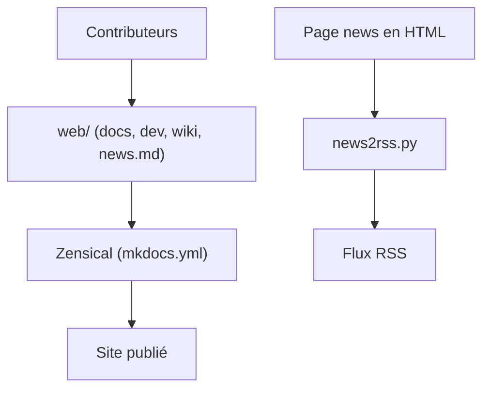

# msys2/msys2.github.io

> Sources Markdown du site web de MSYS2, pour les contributeurs de la documentation.

## Le problème
Maintenir un site de projet (docs, wiki, nouvelles) en collaboration, avec publication automatique.

## Ce que ça fait vraiment
Le site est écrit en Markdown, construit en site statique par Zensical (`mkdocs.yml`) et déployé sur GitHub Pages à chaque commit sur `main`. Un script Python (`news2rss.py`) convertit la page de nouvelles en flux RSS ; le code ne montre pas comment il est appelé.

## Comment c'est branché


## Essayer
```bash
uv run zensical serve --config-file mkdocs.yml
./linkcheck.sh
```

## Coût et pièges
Gratuit. `linkcheck.sh` demande Docker. Le dialecte Markdown de Zensical diffère de celui de GitHub. La licence est présente mais non identifiée.

## Ce que ce n'est pas
Pas MSYS2 lui-même, ni un outil réutilisable : ce sont les sources d'un site.

## Alternatives
Aucune alternative citée dans le README.

## Pour toi
Ignorer : source d'un site web de projet, utile seulement si tu contribues à la documentation de MSYS2.

