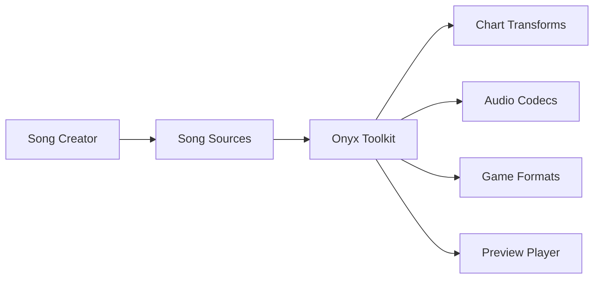

# mtolly/onyx

> Toolkit for creating and converting songs for Rock Band 3 and similar rhythm games.

## The problem
Transcribing a song and converting it to the formats specific to each rhythm game is laborious.

## What it actually does
The Onyx program, written in Haskell, transforms song sources, converts audio, and encrypts and packages assets for each platform. Native utilities handle codecs (Wwise, GameCube DSP, MOGG), FSBank, ARK archives and NPData. A web player previews songs and a site compiler publishes the catalog. The repository also contains song charts by other authors.

## How it is wired

## Trying it
No command documented: the README points to the releases page.

## Cost and gotchas
Free. The catalog declares no license; the README says the software is under GPL v3 and the transcriptions under CC BY-SA, but other authors have different rights. The compositions remain the property of the artists.

## What it is not
Not a game: a creation toolchain. Some Haskell modules are missing from the architecture sample.

## Alternatives
The README names no alternative.

## For you
Ignore: niche tooling for rhythm games, unrelated to data or AI.
