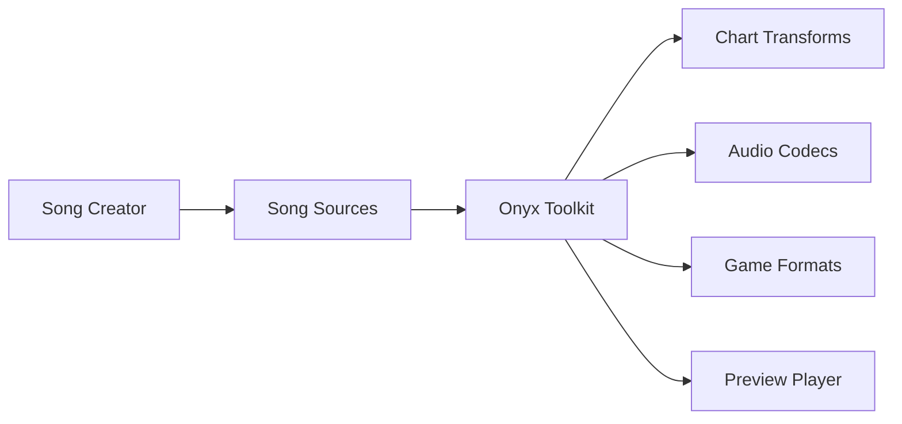

# mtolly/onyx

> Boîte à outils pour créer et convertir des morceaux pour Rock Band 3 et jeux de rythme similaires.

## Le problème
Transcrire un morceau et le convertir dans les formats propres à chaque jeu de rythme est laborieux.

## Ce que ça fait vraiment
Le programme Onyx, écrit en Haskell, transforme les sources de morceaux, convertit l'audio, chiffre et empaquette les ressources pour chaque plateforme. Des utilitaires natifs gèrent les codecs (Wwise, DSP GameCube, MOGG), FSBank, les archives ARK et NPData. Un lecteur web prévisualise les morceaux et un compilateur de site publie le catalogue. Le dépôt contient aussi des chartes de morceaux d'autres auteurs.

## Comment c'est branché

## Essayer
Aucune commande documentée : le README renvoie vers la page des releases.

## Coût et pièges
Gratuit. Le catalogue ne déclare aucune licence ; le README dit que le logiciel est sous GPL v3 et les transcriptions sous CC BY-SA, mais d'autres auteurs ont des droits différents. Les compositions restent la propriété des artistes.

## Ce que ce n'est pas
Pas un jeu : une chaîne d'outils de création. Il manque des modules Haskell dans l'échantillon d'architecture.

## Alternatives
Le README ne nomme pas d'alternative.

## Pour toi
Ignorer : outillage de niche pour jeux de rythme, sans lien avec la data ou l'IA.

