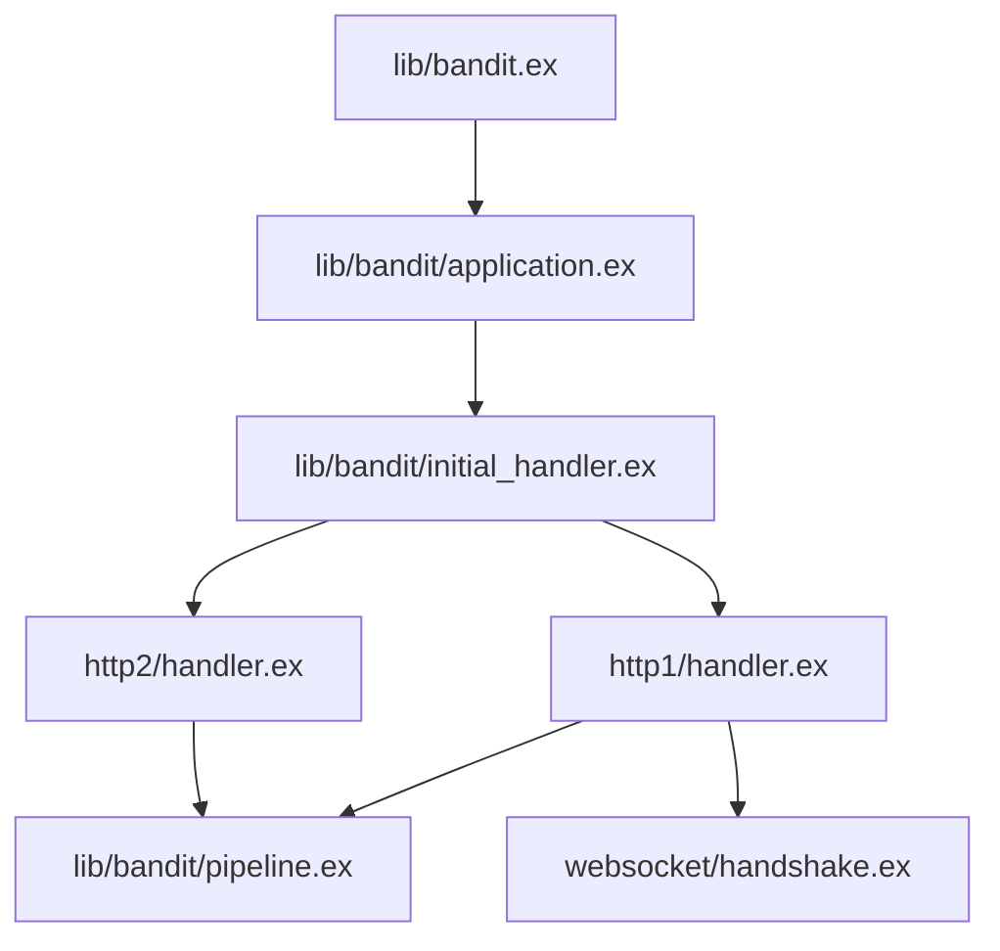

# mtrudel/bandit

> HTTP server in Elixir for Plug and Phoenix applications, supporting HTTP/1, HTTP/2 and WebSocket.

## The problem
An Elixir HTTP server must be correct on the protocols while staying readable and fast.

## What it actually does
Bandit builds on Thousand Island: an initial handler detects the protocol then routes to HTTP/1 or HTTP/2, requests go through a pipeline to the Plug application, and WebSocket upgrades are negotiated by a handshake. It has been Phoenix's default server since 1.7.11.

## How it is wired


## Trying it
```bash
# Dans mix.exs : {:bandit, "~> 1.8"}
# Dans config/config.exs : adapter: Bandit.PhoenixAdapter
```
```elixir
Bandit.start_link(plug: MyPlug)
```

## Cost and gotchas
Free. You need Elixir (not in the list of prerequisites). Never receive the `{:bandit, _}` or `{:plug_conn, :sent}` messages in a Plug.

## What it is not
Not a web framework: it serves Plug applications. The speed figures against Cowboy come from the project itself.

## Alternatives
Cowboy, cited in the README as the reference server, slower according to the author.

## For you
Ignore: an Elixir server, useful only if you develop in Phoenix, which is not your data / AI / MLOps profile.
