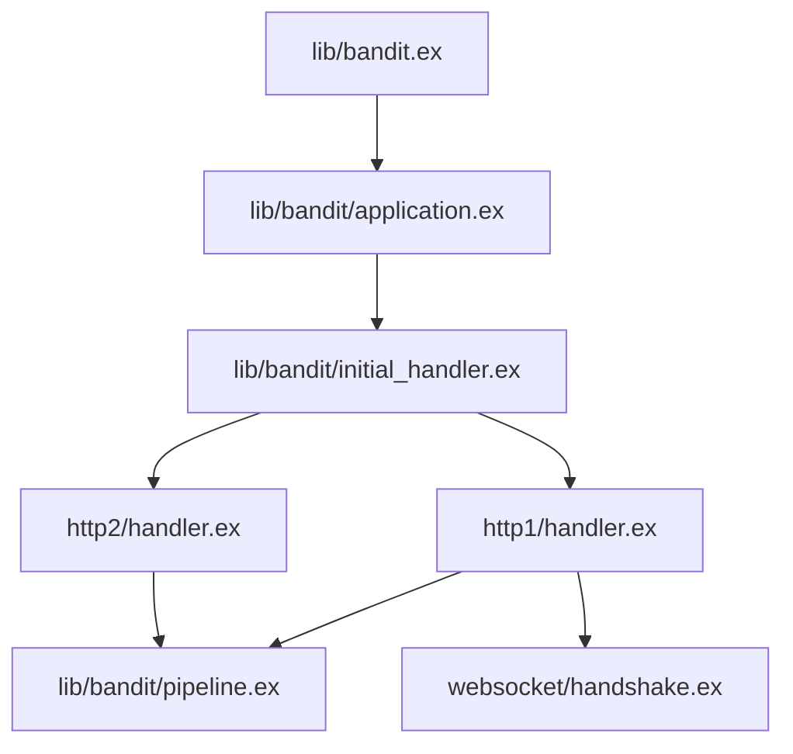

# mtrudel/bandit

> Serveur HTTP en Elixir pour applications Plug et Phoenix, compatible HTTP/1, HTTP/2 et WebSocket.

## Le problème
Un serveur HTTP Elixir doit être correct sur les protocoles tout en restant lisible et rapide.

## Ce que ça fait vraiment
Bandit s'appuie sur Thousand Island : un handler initial détecte le protocole puis aiguille vers HTTP/1 ou HTTP/2, les requêtes passent par un pipeline vers l'application Plug, et les mises à niveau WebSocket sont négociées par un handshake. C'est le serveur par défaut de Phoenix depuis la 1.7.11.

## Comment c'est branché


## Essayer
```bash
# Dans mix.exs : {:bandit, "~> 1.8"}
# Dans config/config.exs : adapter: Bandit.PhoenixAdapter
```
```elixir
Bandit.start_link(plug: MyPlug)
```

## Coût et pièges
Gratuit. Il faut Elixir (hors liste des prérequis). Ne jamais recevoir dans un Plug les messages `{:bandit, _}` ou `{:plug_conn, :sent}`.

## Ce que ce n'est pas
Pas un framework web : il sert des applications Plug. Les chiffres de vitesse face à Cowboy viennent du projet lui-même.

## Alternatives
Cowboy, cité dans le README comme serveur de référence, plus lent d'après l'auteur.

## Pour toi
À ignorer : serveur Elixir, utile seulement si tu développes en Phoenix, ce qui n'est pas ton profil data / IA / MLOps.

