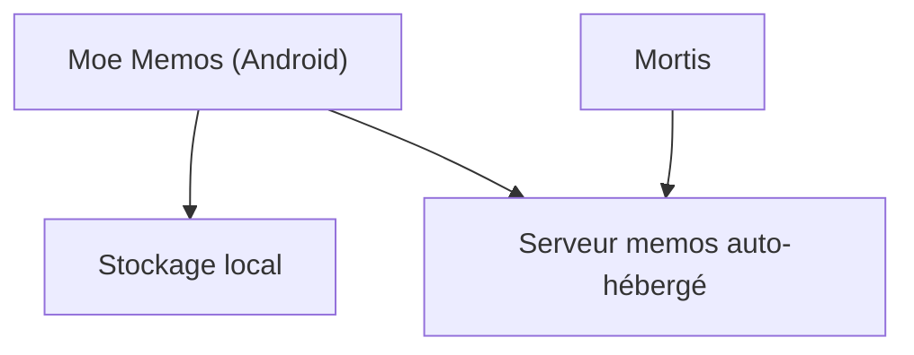

# mudkipme/MoeMemosAndroid

> Third-party Android client for taking short notes, locally or with a self-hosted memos server.

## The problem
Jotting down ideas quickly on mobile and syncing them with your own memos server requires a native app.

## What it actually does
An Android app in Kotlin and Jetpack Compose. It writes memos in Markdown, with images, attachments and to-dos, tags, pinning, search, a widget and sharing. It works offline, locally with backup, or synced with a memos server.

## How it is wired


## Trying it
```bash
# Aucune commande documentée : installer depuis F-Droid, Google Play ou l'APK des Releases.
```

## Cost and gotchas
Free. Compatibility is limited to certain memos versions (0.21.0, 0.27.0 to 0.31.0, 26.10 to 26.11): a server update can break the API.

## What it is not
Not the memos server, with which it is not affiliated. Not a data or AI tool.

## Alternatives
Mortis: converts a newer memos API to the 0.21.0 API to stay compatible.

## For you
Ignore: a personal note-taking app unrelated to your work; relevant only if you already host memos.
