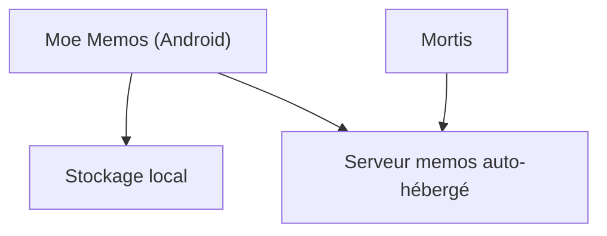

# mudkipme/MoeMemosAndroid

> Client Android tiers pour prendre des notes courtes, en local ou avec un serveur memos auto-hébergé.

## Le problème
Noter des idées rapidement sur mobile et les synchroniser avec son propre serveur memos demande une appli native.

## Ce que ça fait vraiment
Une appli Android en Kotlin et Jetpack Compose. Elle écrit des mémos en Markdown, avec images, pièces jointes et to-do, tags, épinglage, recherche, widget et partage. Elle fonctionne hors ligne, en local avec sauvegarde, ou synchronisée avec un serveur memos.

## Comment c'est branché


## Essayer
```bash
# Aucune commande documentée : installer depuis F-Droid, Google Play ou l'APK des Releases.
```

## Coût et pièges
Gratuit. Compatibilité limitée à certaines versions de memos (0.21.0, 0.27.0 à 0.31.0, 26.10 à 26.11) : une mise à jour du serveur peut casser l'API.

## Ce que ce n'est pas
Pas le serveur memos, avec lequel il n'est pas affilié. Pas un outil data ou IA.

## Alternatives
Mortis : convertit une API memos plus récente vers l'API 0.21.0 pour rester compatible.

## Pour toi
Ignorer : appli de notes personnelle sans lien avec ton métier ; pertinente seulement si tu héberges déjà memos.

