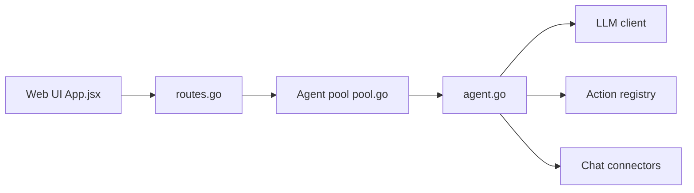

# mudler/LocalAGI

> Self-hosted platform for building no-code AI agents, running locally with LocalAI.

## The problem
Setting up agents with memory, connectors and tools without depending on cloud APIs or writing Python.

## What it actually does
A web interface to configure agents: connectors (Discord, Slack, Telegram, GitHub Issues, IRC, email), a built-in RAG knowledge base, periodic tasks, interpreted Go actions, MCP servers, Skills in the skillserver format. Each agent exposes the OpenAI Responses API. Usable as a Go library, and it also exposes its own MCP at `/mcp`.

## How it is wired


## Trying it
```bash
git clone https://github.com/mudler/LocalAGI
cd LocalAGI
docker compose up
# NVIDIA : docker compose -f docker-compose.nvidia.yaml up
# interface sur http://localhost:8080
```

## Cost and gotchas
Free; local models (e.g. gemma-3-4b-it-qat by default), GPU recommended for multimodal and images. Connector tokens to manage, which widens the attack surface.

## What it is not
Not "100% local" as soon as you plug in Slack or GitHub; custom Go actions run with no described sandbox.

## Alternatives
LocalAI and LocalRecall: building blocks of the same ecosystem, named in the README.

## For you
Watch: handy for prototyping local agents with MCP and RAG; check the isolation before entrusting sensitive actions to it.
