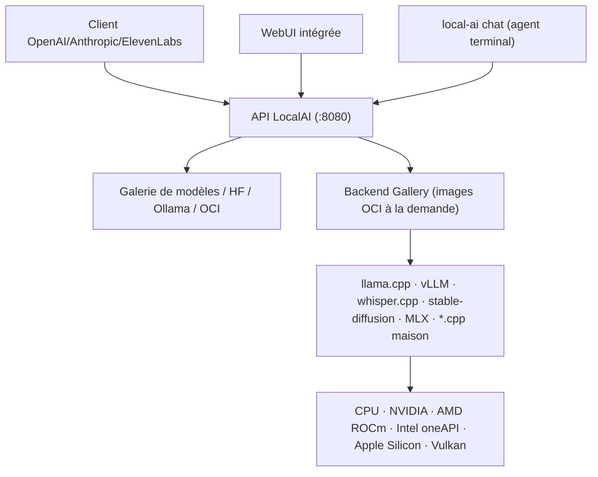

# mudler/LocalAI

> Local multimodal inference engine exposing an OpenAI-compatible API, for those who refuse the cloud.

## The problem
Running LLM, TTS, ASR and image generation locally means stacking llama.cpp, whisper.cpp, vLLM and diffusers, each with its own dependencies.
And application code has to be rewritten every time the engine changes.

## What it actually does
A small Go core and separate backends, each in its own OCI image, downloaded only when a model needs it.
It exposes the OpenAI, Anthropic and ElevenLabs APIs across all backends: text, vision, audio, image, video, embeddings, reranker, object detection.
Models load from an internal gallery, Hugging Face, the Ollama registry, a remote YAML or an OCI image.
Around it: WebUI, API key auth, per-user quotas, distributed mode (PostgreSQL + NATS), MCP, built-in agents with RAG and tools.

## How it is wired


## Trying it
```bash
# CPU seul
docker run -ti --name local-ai -p 8080:8080 localai/localai:latest

# GPU NVIDIA (CUDA 12)
docker run -ti --name local-ai -p 8080:8080 --gpus all localai/localai:latest-gpu-nvidia-cuda-12

# Charger un modèle depuis la galerie
local-ai run llama-3.2-1b-instruct:q4_k_m

# Depuis Hugging Face
local-ai run huggingface://TheBloke/phi-2-GGUF/phi-2.Q8_0.gguf

# Agent terminal contre un serveur déjà lancé
local-ai chat --model llama-3.2-1b-instruct:q4_k_m
```

## Cost and gotchas
Free and local, but each backend is an additional OCI image: disk space and RAM climb quickly once you mix modalities.
The macOS DMG is not signed by Apple and requires `sudo xattr -d com.apple.quarantine` after installation.

## What it is not
Not a model: LocalAI brings no weights, it orchestrates engines and lets you choose the checkpoints.
Not a monolithic bundle — without a downloaded backend, nothing runs, and the first request of a new modality pays the pull.
"Drop-in" compatibility with the OpenAI API remains a reimplementation: the most recent features are not guaranteed.

## Alternatives
llama.cpp: if you only want GGUF text, without the orchestration layer.
vLLM: if you serve a single model at high throughput on GPU, rather than a multimodal catalog.
Ollama: its model registry can be consumed directly by LocalAI, so it is as much a complement as a competitor.

## For you
The right building block if you want an OpenAI-compatible endpoint on your own infrastructure to prototype without an API bill; evaluate latency before any serious use.
