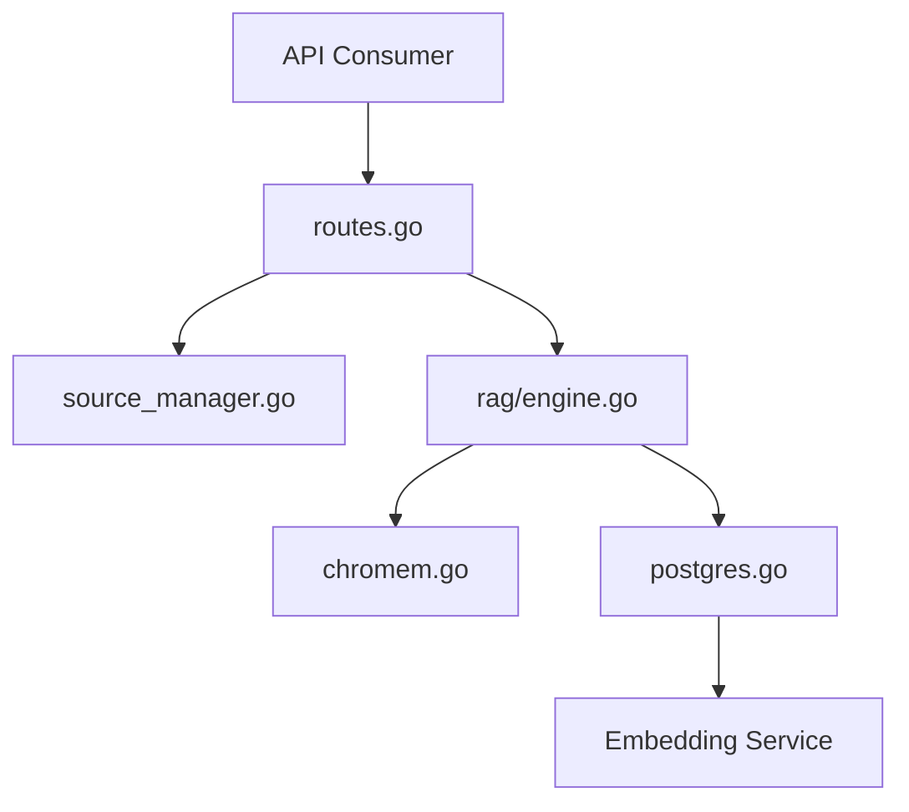

# mudler/LocalRecall

> Lightweight REST API for local vector knowledge bases, giving agents RAG memory.

## The problem
Agents and chatbots need a searchable memory without depending on a cloud service.

## What it actually does
- REST API: collections, file upload (Markdown, text, PDF), search, entries, reset.
- Engines: Chromem (local files, default) or PostgreSQL with hybrid BM25 + vector search.
- External sources watched in the background: web pages, Git repositories, sitemaps.
- Web interface, separate MCP server, optional API keys.

## How it is wired


## Trying it
```bash
go build -o localrecall
./localrecall
docker compose up -d
curl -X POST $BASE_URL/collections -H "Content-Type: application/json" -d '{"name":"myCollection"}'
curl -X POST $BASE_URL/collections/myCollection/search -H "Content-Type: application/json" -d '{"query":"search term", "max_results":5}'
```

## Cost and gotchas
You need an OpenAI-compatible embeddings service (e.g. LocalAI) via `OPENAI_BASE_URL`. PostgreSQL recommended in production. Stated prerequisite: Go 1.16+.

## What it is not
Not an LLM nor an agent framework: only the memory layer. "No GPU" only holds if embeddings run elsewhere or on CPU.

## Alternatives
None named as such; integrates with LocalAI and LocalAGI.

## For you
Adopt for a simple local RAG: MIT, active (push 2026-10-12), two engines to choose from; keep an eye on the single maintainer.
