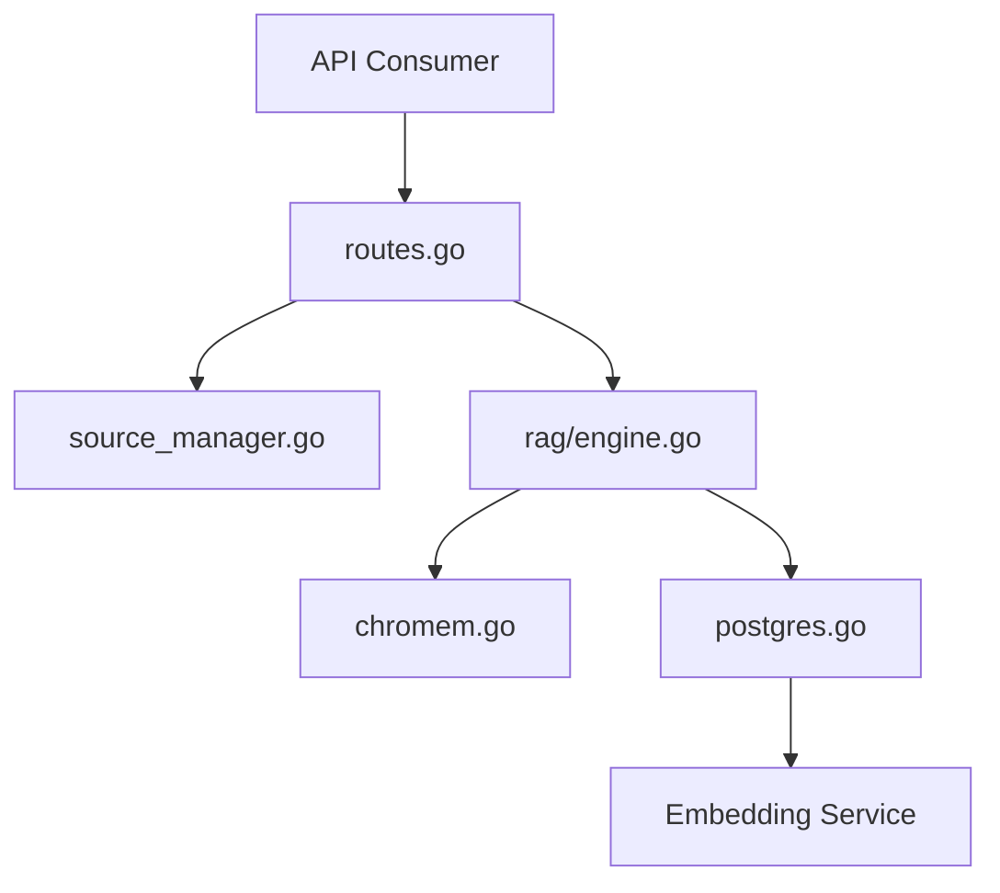

# mudler/LocalRecall

> API REST légère de bases de connaissances vectorielles locales, pour donner une mémoire RAG à des agents.

## Le problème
Les agents et chatbots ont besoin d'une mémoire interrogeable sans dépendre d'un service cloud.

## Ce que ça fait vraiment
- API REST : collections, envoi de fichiers (Markdown, texte, PDF), recherche, entrées, reset.
- Moteurs : Chromem (fichiers locaux, défaut) ou PostgreSQL avec recherche hybride BM25 + vecteurs.
- Sources externes surveillées en tâche de fond : pages web, dépôts Git, sitemaps.
- Interface web, serveur MCP séparé, clés d'API optionnelles.

## Comment c'est branché


## Essayer
```bash
go build -o localrecall
./localrecall
docker compose up -d
curl -X POST $BASE_URL/collections -H "Content-Type: application/json" -d '{"name":"myCollection"}'
curl -X POST $BASE_URL/collections/myCollection/search -H "Content-Type: application/json" -d '{"query":"search term", "max_results":5}'
```

## Coût et pièges
Il faut un service d'embeddings compatible OpenAI (ex. LocalAI) via `OPENAI_BASE_URL`. PostgreSQL recommandé en production. Prérequis annoncé : Go 1.16+.

## Ce que ce n'est pas
Pas un LLM ni un framework d'agent : seulement la couche mémoire. « Sans GPU » ne vaut que si les embeddings tournent ailleurs ou sur CPU.

## Alternatives
Aucune nommée comme telle ; s'intègre avec LocalAI et LocalAGI.

## Pour toi
À adopter pour un RAG local simple : MIT, actif (push 2026-10-12), deux moteurs au choix ; surveille le mainteneur unique.

