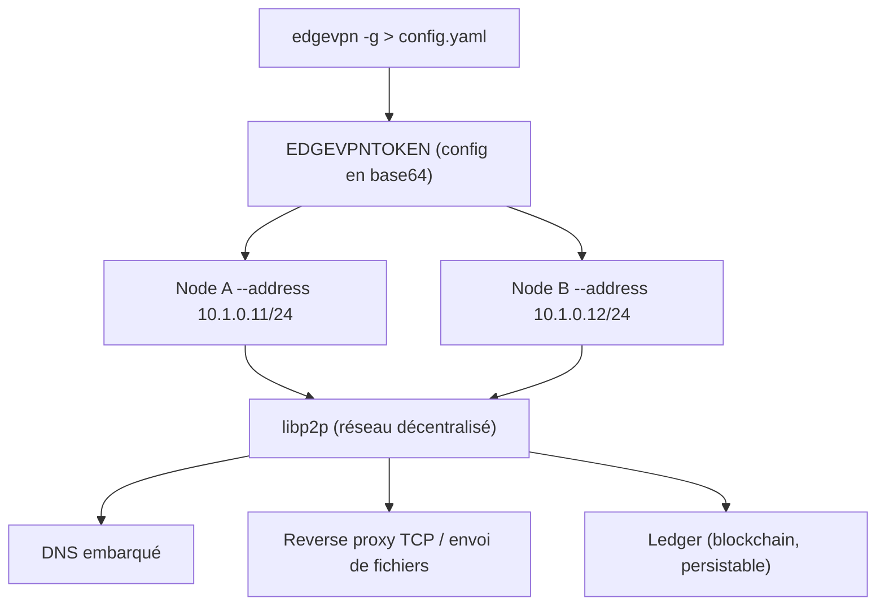

# mudler/edgevpn

> Peer-to-peer VPN and reverse proxy with no central server, driven by a simple shared token.

## The problem
Connecting machines behind NATs requires either a central server to maintain, or an ngrok-type service with its dependency and subscription.

## What it actually does
Relies on libp2p to build decentralized private networks reachable through a shared secret. It sets up a VPN between peers with automatic IP assignment and a small embedded DNS server; it exposes a TCP service through a reverse proxy to the p2p network, like ngrok but with no infrastructure; it sends files p2p without setting up a VPN; and it can be used as a Go library to embed a distributed ledger (this is what powers LocalAI's P2P features). Trust zones restrict which peers are allowed — the README notes they are experimental and do not currently prevent a token holder from getting in. A React web interface is compiled into the binary, and a Linux desktop GUI exists in alpha.

## How it is wired


## Trying it
```bash
curl -sfL https://raw.githubusercontent.com/mudler/edgevpn/master/install.sh | sh
edgevpn -g > config.yaml
EDGEVPNTOKEN=$(edgevpn -g -b)
EDGEVPNTOKEN=.. edgevpn --address 10.1.0.11/24
make build            # builds the UI if needed, then the Go binary
mkdir -p api/react-ui/dist && touch api/react-ui/dist/index.html
```

## Cost and gotchas
Free, static binary. **The README warns twice that the software has not undergone a full security audit** and advises against sensitive traffic and production use. The decentralized approach is chatty and poorly suited to low-latency workloads. Establishing connections can take several minutes. The configuration file amounts to full control of the network: distributing it means handing over everything. Building requires Node 20.19+ for the UI embedded via `//go:embed`.

## What it is not
It is not an audited or supported product: the author presents it as his first libp2p experiment. It is not a replacement for Tailscale or WireGuard in the enterprise. Trust zones are not yet a real barrier.

## Alternatives
- ngrok, cited as the reference of which the author wanted a "more open" version with no infrastructure to maintain.

## For you
Clever for a test k3s cluster between machines at home; not to be put in production.
