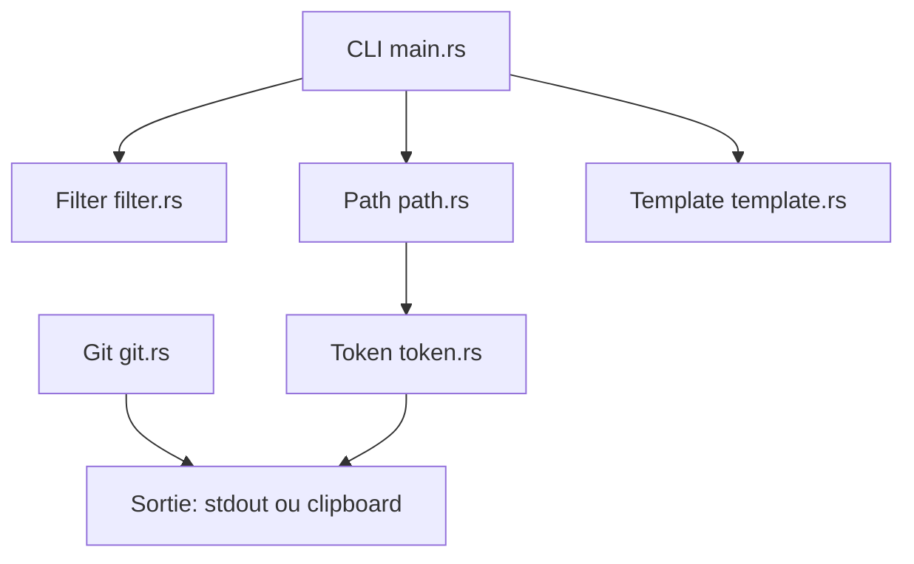

# mufeedvh/code2prompt

> Rust tool that converts a code repository into a single prompt for LLMs.

## The problem
Copying files by hand into a chat is slow, messy and ignores the token budget.

## What it actually does
`code2prompt` walks a folder while respecting `.gitignore`, filters by globs, renders a Handlebars template, estimates tokens and outputs to stdout, a file or the clipboard. It includes Git diffs and logs, and reads CSV, notebooks and JSONL. Also provided: TUI, Python SDK, MCP server and agent skill.

## How it is wired


## Trying it
```bash
cargo install code2prompt
brew install code2prompt
pip install code2prompt-rs
code2prompt .
code2prompt path/to/project --output-file prompt.txt
```

## Cost and gotchas
Free. Building from source requires Git, Rust and Cargo. The token estimate is approximate: the rendered prompt is not re-tokenized.

## What it is not
Not an agent nor a semantic search tool: it assembles context, it does not analyze it. It does not choose for you which files are useful.

## Alternatives
No alternative named in the README.

## For you
Adopt it to quickly prepare code context to give to an LLM, with an estimated token budget.
