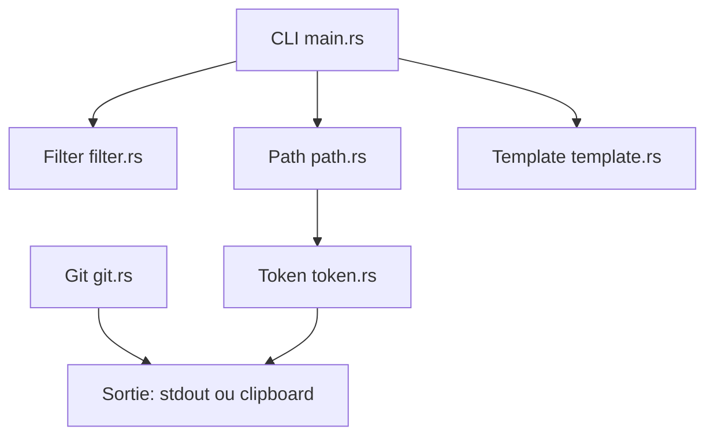

# mufeedvh/code2prompt

> Outil Rust qui convertit un dépôt de code en un prompt unique pour LLM.

## Le problème
Copier à la main des fichiers dans un chat est lent, désordonné et ignore le budget de tokens.

## Ce que ça fait vraiment
`code2prompt` parcourt un dossier en respectant `.gitignore`, filtre par globs, rend un gabarit Handlebars, estime les tokens et sort sur stdout, dans un fichier ou le presse-papiers. Il intègre diffs et logs Git, lit CSV, notebooks et JSONL. Fournis aussi : TUI, SDK Python, serveur MCP et skill d'agent.

## Comment c'est branché


## Essayer
```bash
cargo install code2prompt
brew install code2prompt
pip install code2prompt-rs
code2prompt .
code2prompt path/to/project --output-file prompt.txt
```

## Coût et pièges
Gratuit. Compilation depuis les sources demande Git, Rust et Cargo. L'estimation de tokens est approximative : le prompt rendu n'est pas re-tokenisé.

## Ce que ce n'est pas
Pas un agent ni un outil de recherche sémantique : il assemble du contexte, il ne l'analyse pas. Il ne choisit pas à ta place quels fichiers sont utiles.

## Alternatives
Aucune alternative nommée dans le README.

## Pour toi
À adopter pour préparer rapidement un contexte de code à donner à un LLM, avec un budget de tokens estimé.

