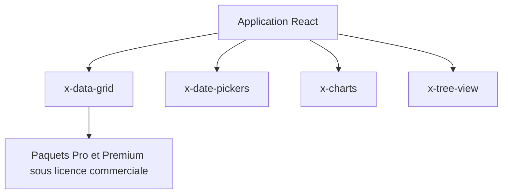

# mui/mui-x

> Advanced React components (data grid, date pickers, charts, tree view) for data-rich applications.

## The problem
Building a data grid, date pickers or complex charts by hand in React is costly to write and maintain.

## What it actually does
Provides npm packages: Data Grid, Date and Time Pickers, Charts, Tree View. The community core is MIT. Advanced features (multi-sorting, column pinning, row grouping, Excel export) require a commercial Pro or Premium license. Extends Material UI but can be used on its own.

## How it is wired
Simplified diagram based on the sheet, no diagram provided.



## Trying it
```bash
# Paquets cités dans le README (commande d'installation non détaillée)
# @mui/x-data-grid-pro, @mui/x-date-pickers-pro, @mui/x-charts-pro, @mui/x-tree-view-pro
```
Installation commands are in each component's documentation, not repeated in the README.

## Cost and gotchas
The core is free, the Pro and Premium plans are paid (prices on the Pricing page). The catalog detects no license on the repo.

## What it is not
Not a data science tool: it is web UI. Not fully free: the features most useful in business are paid.

## Alternatives
No alternative named in the README.

## For you
Keep an eye on it: useful if you build a React dashboard for models, but the advanced grid features are paid.
