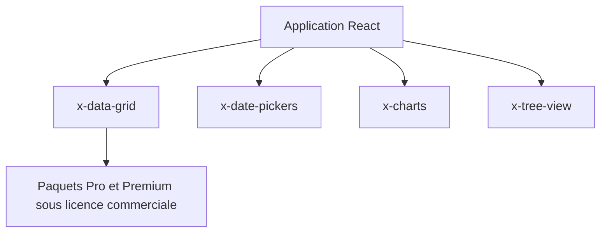

# mui/mui-x

> Composants React avancés (grille de données, sélecteurs de dates, graphiques, arbre) pour applications riches en données.

## Le problème
Construire à la main une grille de données, des sélecteurs de dates ou des graphiques complexes en React coûte cher à écrire et à maintenir.

## Ce que ça fait vraiment
Fournit des paquets npm : Data Grid, Date and Time Pickers, Charts, Tree View. Le noyau communautaire est sous MIT. Les fonctions avancées (multi-tri, épinglage de colonnes, regroupement de lignes, export Excel) exigent une licence commerciale Pro ou Premium. Étend Material UI mais peut s'utiliser seul.

## Comment c'est branché
Schéma simplifié d'après la fiche, sans diagramme fourni.



## Essayer
```bash
# Paquets cités dans le README (commande d'installation non détaillée)
# @mui/x-data-grid-pro, @mui/x-date-pickers-pro, @mui/x-charts-pro, @mui/x-tree-view-pro
```
Les commandes d'installation sont dans la documentation de chaque composant, non reprises dans le README.

## Coût et pièges
Le noyau est gratuit, les plans Pro et Premium sont payants (tarifs sur la page Pricing). Le catalogue ne détecte aucune licence au dépôt.

## Ce que ce n'est pas
Pas un outil de data science : c'est de l'interface web. Pas entièrement libre : les fonctions les plus utiles en entreprise sont payantes.

## Alternatives
Aucune alternative nommée dans le README.

## Pour toi
À surveiller : utile si tu bâtis un tableau de bord React pour des modèles, mais les fonctions de grille avancées sont payantes.

