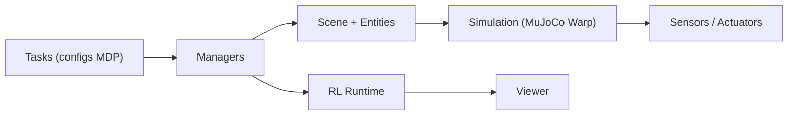

# mujocolab/mjlab

> Robotics reinforcement learning environments, an Isaac Lab-style API on MuJoCo Warp.

## The problem
Training robot policies requires many simulated environments in parallel on GPU, with composable task definitions.

## What it actually does
Reuses Isaac Lab's "manager-based" API (actions, observations, rewards, terminations, events) and runs it on MuJoCo Warp. Provided tasks: velocity, motion imitation, manipulation, cartpole; Unitree G1/Go1 and i2rt_yam robots. Multi-GPU training, sensors, actuators, terrains, viser viewer. macOS is only for evaluation.

## How it is wired


## Trying it
```bash
uvx --from mjlab --refresh demo
git clone https://github.com/mujocolab/mjlab.git && cd mjlab
uv run train Mjlab-Velocity-Flat-Unitree-G1 --env.scene.num-envs 4096
uv run play Mjlab-Velocity-Flat-Unitree-G1 --wandb-run-path your-org/mjlab/run-id
```

## Cost and gotchas
An NVIDIA GPU is required for training. Runs are tracked with Weights & Biases. Part of the code comes from Isaac Lab (BSD-3, headers kept).

## What it is not
Not a simulator: it relies on MuJoCo Warp. Not general-purpose RL outside robotics.

## Alternatives
Isaac Lab (whose API it reuses), cited in the README.

## For you
Watch: the no-install demo costs little, but the interest is real only if you do robotics with RL.
