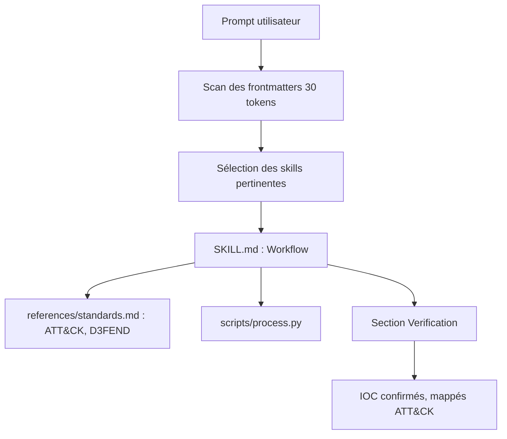

# mukul975/Anthropic-Cybersecurity-Skills

> Community library of 818 cybersecurity skills structured for AI agents, mapped to six frameworks.

## The problem
A general-purpose agent can write code and search the web, but does not know which Volatility3 plugin to run on a memory dump.
Existing repositories provide wordlists or exploits, not an analyst's decision process.

## What it actually does
818 skills across 34 domains (cloud, SOC, threat hunting, forensics, IAM, malware, red team, containers, OT/ICS, API, IR…), following the open agentskills.io standard.
Each skill is a folder: `SKILL.md` with YAML frontmatter and a Markdown body (When to Use, Prerequisites, Workflow, Verification), plus `references/`, `scripts/` and `assets/`.
Mapping to six frameworks depending on the nature of the skill: MITRE ATT&CK v19.1 (805 skills), NIST CSF 2.0 (804), D3FEND (139), NIST AI RMF (97), MITRE F3 (94), ATLAS (93).
Progressive disclosure: about 30 tokens to scan a frontmatter, 500 to 2,000 to load the full workflow, which makes it possible to sweep the whole library in one pass.

## How it is wired


## Trying it
```bash
npx skills add mukul975/Anthropic-Cybersecurity-Skills
```

```bash
git clone https://github.com/mukul975/Anthropic-Cybersecurity-Skills.git
cd Anthropic-Cybersecurity-Skills
```

## Cost and gotchas
Free, Apache-2.0 on the skills. No runtime cost beyond your agent's tokens.
Offensive and dual-use content (red team C2, phishing simulation, exploitation): strictly authorized use, on systems you own or with written consent.

## What it is not
It is not an Anthropic project despite the name: the README flags it upfront as independent and community-made.
It is neither a collection of scripts nor a scanner: these are text playbooks that the agent follows.
The counts are inconsistent with each other (817 or 818 depending on the section) and a promotional box (survey, Casky.ai playground) takes up part of the README.

## Alternatives
The README names no competitor; it cites the indexes where it is listed (VoltAgent/awesome-agent-skills, ottosulin/awesome-ai-security).

## For you
Worth picking from for the shape of the skills (frontmatter, Workflow, Verification) more than for the security content itself.
