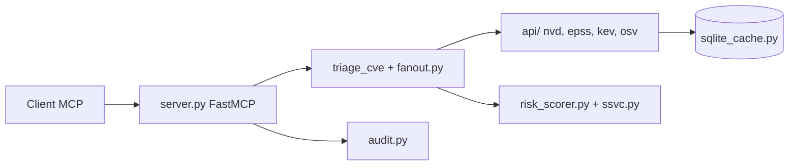

# mukul975/cve-mcp-server

> Security intelligence MCP server that aggregates NVD, EPSS, CISA KEV and other sources to triage CVEs.

## The problem
Deciding whether to patch a CVE means cross-checking NVD, EPSS, CISA KEV, exploit repositories and threat databases across several tabs.

## What it actually does
A Python FastMCP server exposing about thirty tools (CVE search, EPSS, KEV, MITRE ATT&CK, OSV dependency scan, IP, malware). The `triage_cve` tool queries NVD, EPSS and KEV in parallel, computes a composite score from 0 to 100 with KEV as a CRITICAL floor, and proposes an SSVC decision in `deep` mode. SQLite cache, audit log, stdio or HTTP transport.

## How it is wired


## Trying it
```bash
git clone https://github.com/mukul975/cve-mcp-server.git
cd cve-mcp-server
python -m venv venv && source venv/bin/activate
pip install -e .
cp .env.example .env
python -m cve_mcp.server
```

## Cost and gotchas
Eight tools work without a key; the others require free keys with limited quotas (NVD, GitHub, AbuseIPDB, VirusTotal, GreyNoise, Shodan). All requests go out to third-party APIs. The README contains a call to answer a university survey.

## What it is not
Not an active scanner: lookup only. The README is inconsistent (28 or 27 tools, variable names `..._API_KEY` and `..._KEY`).

## Alternatives
No alternative named in the README.

## For you
Worth watching: relevant for an AI security team, but a young repository, a single maintainer and inconsistent documentation.
