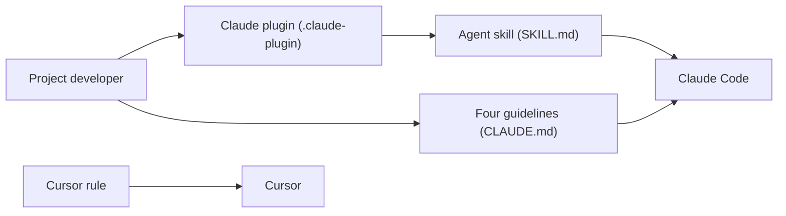

# multica-ai/andrej-karpathy-skills

> A CLAUDE.md file containing four principles to reduce common errors made by code reviewers.

## The problem
The models make assumptions without verification, overcomplicate things, modify code without authorization, and lack clear success criteria.

## What it actually does
The repository provides four rules derived from Andrej Karpathy's observations: think before coding, prioritize simplicity, surgical changes, and execution guided by verifiable objectives. They are provided in the CLAUDE.md file, the Claude Code plugin, and the Cursor rule. There is no executable logic.

## How it is wired


## Trying it
```bash
/plugin marketplace add forrestchang/andrej-karpathy-skills
/plugin install andrej-karpathy-skills@karpathy-skills
curl -o CLAUDE.md https://raw.githubusercontent.com/forrestchang/andrej-karpathy-skills/main/CLAUDE.md
```

## Cost and gotchas
No cost. The license is not listed in the catalog: reuse of the text needs clarification. The instructions encourage caution, which slows down simple tasks.

## What it is not
This is not a complete working method or Karpathy's own code: it is a paraphrase by a third party. The README also promotes another project (Multica).

## Alternatives
- Superpowers: A comprehensive and automated methodology, rather than relying on four principles.
- gstack: a workflow layer that, according to its own README, enforces the same principles.

## For you
As a basic guideline: four short rules to include in a CLAUDE.md file cost very little, but be sure to check the license before redistributing them.
