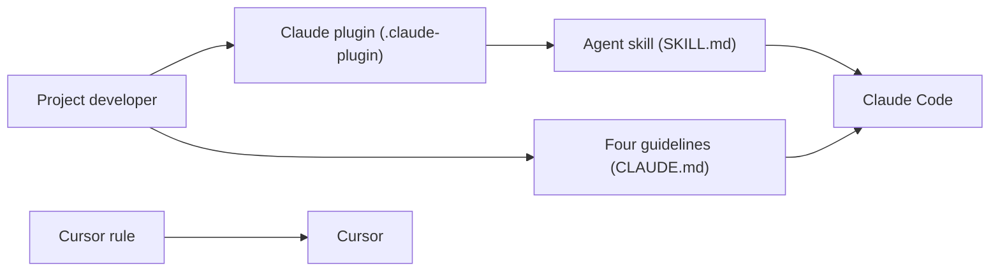

# multica-ai/andrej-karpathy-skills

> Un fichier CLAUDE.md de quatre principes pour réduire les erreurs courantes des agents de code.

## Le problème
Les modèles supposent sans vérifier, sur-compliquent, modifient du code non demandé et manquent de critères de succès.

## Ce que ça fait vraiment
Le dépôt distribue quatre règles dérivées d'observations d'Andrej Karpathy : réfléchir avant de coder, simplicité d'abord, changements chirurgicaux, exécution guidée par des objectifs vérifiables. Elles sont livrées en fichier CLAUDE.md, en plugin Claude Code et en règle Cursor. Aucune logique exécutable.

## Comment c'est branché


## Essayer
```bash
/plugin marketplace add forrestchang/andrej-karpathy-skills
/plugin install andrej-karpathy-skills@karpathy-skills
curl -o CLAUDE.md https://raw.githubusercontent.com/forrestchang/andrej-karpathy-skills/main/CLAUDE.md
```

## Coût et pièges
Aucun coût. La licence est absente du catalogue : réutilisation du texte à clarifier. Les instructions biaisent vers la prudence, ce qui ralentit les tâches triviales.

## Ce que ce n'est pas
Pas une méthode de travail complète, ni un code de Karpathy lui-même : c'est une paraphrase par un tiers. Le README signale aussi la promotion d'un autre projet (Multica).

## Alternatives
- Superpowers : méthodologie complète et automatisée plutôt que quatre principes.
- gstack : couche de workflow qui, selon son propre README, impose les mêmes principes.

## Pour toi
À adopter à titre de base : quatre règles courtes à coller dans un CLAUDE.md coûtent presque rien, mais vérifie la licence avant de les redistribuer.

