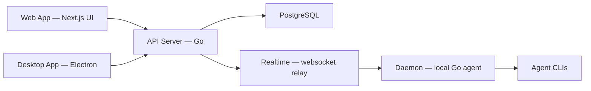

# multica-ai/multica

> A task management dashboard where command-line agents receive, execute, and submit tasks, for teams.

## The problem
Several agents (such as Claude Code and Codex) operate independently within a terminal, losing track of the overall context and requiring individual monitoring.

## What it actually does
Backend Go (Chi, sqlc, WebSocket) + PostgreSQL, clients Next.js, Electron and Expo.
A local daemon requests tasks and launches one of the 26 agent CLI installed on your machine.
Issue assignment, cron-based automation, squads, skills, execution logs, token costs, review process.
GitHub/GitLab/Gitea, Slack, Lark integrations; auto-hosting with Docker Compose or Helm.

## How it is wired


## Trying it
```bash
curl -fsSL https://raw.githubusercontent.com/multica-ai/multica/main/scripts/install.sh | bash -s -- --with-server
multica setup self-host
make dev
```

## Cost and gotchas
Does not provide any templates: at least one agent CLI must be installed and authenticated (subscriptions are your responsibility). Self-hosting: Docker is required.

## What it is not
Not an agent or an LLM: an orchestrator. Only for iOS, requiring manual compilation. The `main` function changes almost daily.

## Alternatives
Not documented.

## For you
Interesting for managing multiple agents as a team; license needs to be clarified before any serious use.
