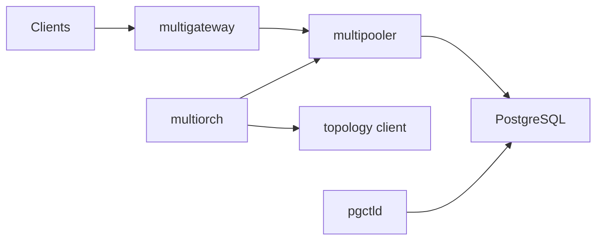

# multigres/multigres

> Adaptation of Vitess for Postgres: gateway, pooling and orchestration for distributed Postgres.

## The problem
Postgres scales poorly horizontally: pooling, failover after an outage and backups are cobbled together by hand.

## What it actually does
The README is very short: an early-stage project, pointing to a website and an EKS guide. From the code: `multigateway` (SQL over the Postgres protocol), `multipooler` (pools and gRPC), `multiorch` (failover and recovery), `multiadmin`, `pgctld` (Postgres lifecycle), topology on etcd, pgBackRest backups to S3.

## How it is wired

## Trying it
No command documented in the README; it points to the project website and the EKS guide.

## Cost and gotchas
Multi-service deployment (Docker, Kubernetes/EKS), etcd and object storage for backups. The project describes itself as early-stage.

## What it is not
Not yet a stable product. README under 800 characters: the sheet relies mostly on the architecture described from the code.

## Alternatives
- Vitess: the project it is an adaptation of.

## For you
Worth watching: relevant if you run data at large scale on Postgres, but too young for production.
