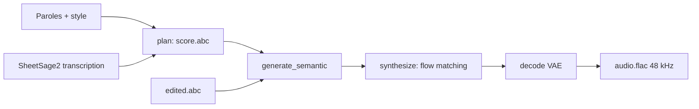

# multimodal-art-projection/YuE

> Full song generation from lyrics, via an editable musical plan.

## The problem
Music generators are black boxes: you cannot see which melody or chords were chosen,
so you cannot fix a harmony, only regenerate and hope.

## What it actually does
YuE2 first writes a melody-chord plan in ABC, then realizes it as a full song with vocals and
accompaniment. The plan is readable, playable and editable by a human or an agent before rendering.
An AR–NAR Mixture-of-Transformers backbone predicts the score and semantic tokens, flow matching
produces the acoustic latents, a VAE decodes to 48 kHz stereo. Staged API: `plan()`,
`generate_semantic()`, `synthesize()`, `decode()`. Three modes: `cot="full"`, `"melody"` (covers), `"off"`.

## How it is wired


## Trying it
```bash
git clone https://github.com/multimodal-art-projection/YuE.git
cd YuE
python3.12 -m venv .venv
source .venv/bin/activate
python -m pip install --upgrade pip
python -m pip install .
python examples/generate.py --output outputs/first-song
```

## Cost and gotchas
Linux, Python 3.12, BF16-compatible NVIDIA GPU with **24 GB of VRAM**. Weights are downloaded from
Hugging Face on first use. SheetSage2, needed for covers, runs in a separate environment.

## What it is not
Not an audio editor: editing the score regenerates a full recording, the original waveform
is not preserved. The README itself states that the gap between the best benchmark averages does
**not** establish statistical significance. License not declared in this README; "licensing inquiries"
contacts are given, which suggests conditions to check.

## Alternatives
- **ACE-Step 1.5**: public weights, evaluated in the same table.
- **DiffRhythm 2**: public weights, lower scores on SongBench Avg.
- **SongBloom**: public weights, last in the cited ranking.

## For you
A serious curiosity: the explicit score is the first real control lever in music generation.
