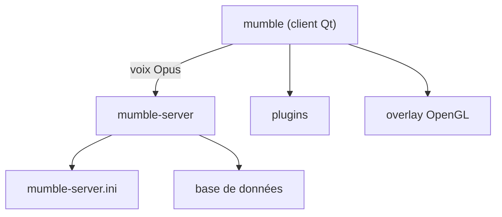

# mumble-voip/mumble

> Open-source low-latency voice chat, client and server, built on Qt and Opus.

## The problem
Talking in a group by voice, with low latency and without a proprietary service, for example during games.

## What it actually does
Two modules: the client (mumble) and the server (mumble-server, formerly murmur). The client runs on Windows, Linux, FreeBSD, OpenBSD and macOS. It offers plugins and an OpenGL overlay for games. The server is launched from the command line with a SuperUser password and an ini file.

## How it is wired

Simplified diagram: the README provides no diagram.

## Trying it
```bash
mumble-server [--set-su-pw <password>] [--ini <inifile>] [--foreground] [--verbose]
mumble-overlay gamename
LD_PRELOAD=/path/to/libmumble.so.1.1 gamename
```

## Cost and gotchas
Free. The master branch is unstable: for a stable version, pick the release branch (e.g. 1.5.x). On macOS, the server is distributed separately. The SuperUser is disabled until a password is set.

## What it is not
Not a data or AI tool. Not a hosted service: you host your own server. License present but not identified by GitHub.

## Alternatives
No alternative named in the README.

## For you
Ignore for a data/AI/MLOps profile: it is real-time voice software unrelated to your field, even though it is solid and very active.
