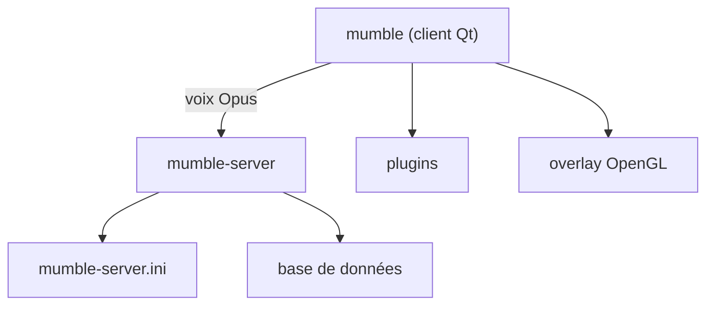

# mumble-voip/mumble

> Chat vocal open source à faible latence, client et serveur, bâti sur Qt et Opus.

## Le problème
Communiquer à plusieurs en voix, avec peu de latence et sans service propriétaire, par exemple pendant des jeux.

## Ce que ça fait vraiment
Deux modules : le client (mumble) et le serveur (mumble-server, ex-murmur). Le client tourne sur Windows, Linux, FreeBSD, OpenBSD et macOS. Il propose des plugins et un overlay OpenGL pour les jeux. Le serveur se lance en ligne de commande avec un mot de passe SuperUser et un fichier ini.

## Comment c'est branché

Schéma simplifié : le README ne fournit pas de diagramme.

## Essayer
```bash
mumble-server [--set-su-pw <password>] [--ini <inifile>] [--foreground] [--verbose]
mumble-overlay gamename
LD_PRELOAD=/path/to/libmumble.so.1.1 gamename
```

## Coût et pièges
Gratuit. La branche master est instable : pour une version stable, choisir la branche de release (ex. 1.5.x). Sur macOS, le serveur est distribué séparément. Le SuperUser est désactivé tant qu'aucun mot de passe n'est défini.

## Ce que ce n'est pas
Pas un outil data ou IA. Pas un service hébergé : tu héberges ton serveur. Licence présente mais non identifiée par GitHub.

## Alternatives
Aucune alternative nommée dans le README.

## Pour toi
À ignorer pour un profil data/IA/MLOps : c'est un logiciel de voix en temps réel sans lien avec ton métier, même s'il est solide et très actif.

