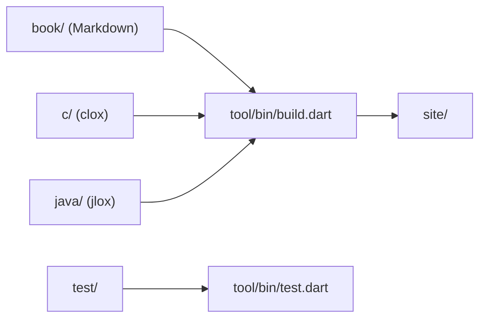

# munificent/craftinginterpreters

> Source of the book "Crafting Interpreters": text, two Lox interpreters and build chain.

## The problem
Learning to write an interpreter requires a guide that works from end to end.

## What it actually does
Contains the book's Markdown, jlox (Java), clox (C), a Lox test suite and a site generator written in Dart that weaves prose and code snippets together. You can build the interpreter at the end of each chapter and run the tests against your own Lox implementation.

## How it is wired


## Trying it
```bash
make get
make
./clox
./jlox
```

## Cost and gotchas
Free. Prerequisites: Dart, a C compiler, `javac`. Last push in August 2024; license present but not identified by GitHub.

## What it is not
Not the book readable as is: the published site is at craftinginterpreters.com. The answers are in `note/answers`.

## Alternatives
No alternative named in the README.

## For you
Worth watching if you want to understand compilers and interpreters (useful for DSLs or execution engines): stable content, a single author, little activity.
