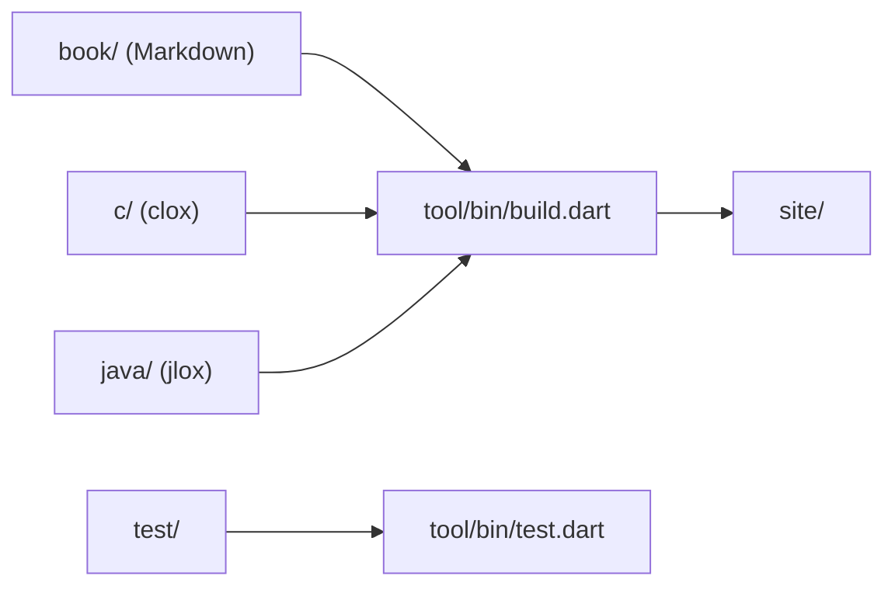

# munificent/craftinginterpreters

> Source du livre « Crafting Interpreters » : texte, deux interpréteurs Lox et chaîne de build.

## Le problème
Apprendre à écrire un interpréteur exige un guide qui fonctionne de bout en bout.

## Ce que ça fait vraiment
Contient le Markdown du livre, jlox (Java), clox (C), une suite de tests Lox et un générateur de site écrit en Dart qui tisse prose et extraits de code. On peut compiler l'interpréteur à la fin de chaque chapitre et lancer les tests sur sa propre implémentation de Lox.

## Comment c'est branché


## Essayer
```bash
make get
make
./clox
./jlox
```

## Coût et pièges
Gratuit. Prérequis : Dart, un compilateur C, `javac`. Dernier push en août 2024 ; licence présente mais non identifiée par GitHub.

## Ce que ce n'est pas
Pas le livre lisible tel quel : le site publié est sur craftinginterpreters.com. Les corrigés sont dans `note/answers`.

## Alternatives
Aucune alternative nommée dans le README.

## Pour toi
À surveiller si tu veux comprendre compilateurs et interpréteurs (utile pour DSL ou moteurs d'exécution) : contenu stable, un seul auteur, peu actif.

