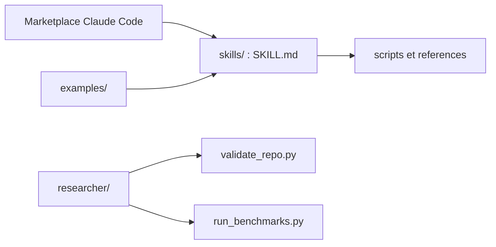

# muratcankoylan/Agent-Skills-for-Context-Engineering

> Collection of skills on context management and agent loops, for designers of agent systems.

## The problem
In agent systems, the context window degrades with length ("lost in the middle", poisoning, distraction), and few documents guide the design of context, memory and evaluation.

## What it actually does
Seventeen skills: context fundamentals and degradation, compression, optimization, multi-agent, memory, tool design, evaluation (including LLM-as-judge), harness engineering, self-improvement loops, BDI models. Added to these are complete examples and a `researcher/` folder: source registry, rubrics, Python validators, a continuous loop. The README cites skill-routing measurements on four models.

## How it is wired


## Trying it
```bash
/plugin marketplace add muratcankoylan/Agent-Skills-for-Context-Engineering
/plugin install context-engineering@context-engineering-marketplace
python3 -m pip install -r requirements-dev.txt
python3 researcher/scripts/validate_repo.py --strict
```

## Cost and gotchas
Free. The `researcher/` loop is described for launchd (macOS) and does not call a paid LLM. The scripts are illustrations in Python pseudo-code.

## What it is not
Not an executable library: these are instructions and principles. The benchmark figures are the author's; reproduce them before relying on them.

## Alternatives
No alternative named in the README.

## For you
Worth watching: good reading material on agent context and evaluation, but part of the repository (research loop, exports) is the author's personal tooling.
