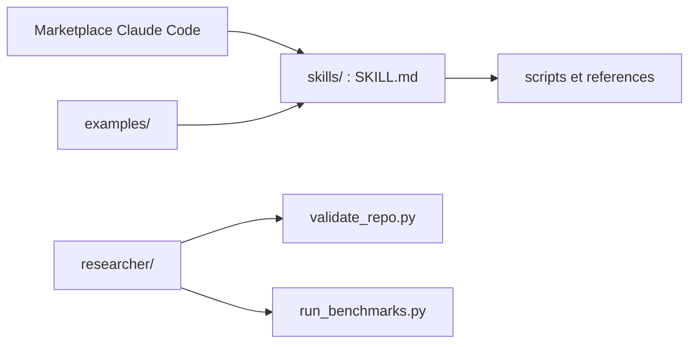

# muratcankoylan/Agent-Skills-for-Context-Engineering

> Collection de skills sur la gestion du contexte et des boucles d'agents, pour concepteurs de systèmes d'agents.

## Le problème
Dans les systèmes d'agents, la fenêtre de contexte se dégrade avec la longueur (« lost in the middle », empoisonnement, distraction) et peu de documents guident la conception du contexte, de la mémoire et de l'évaluation.

## Ce que ça fait vraiment
Dix-sept skills : fondamentaux et dégradation du contexte, compression, optimisation, multi-agents, mémoire, conception d'outils, évaluation (dont LLM-as-judge), harness engineering, boucles d'auto-amélioration, modèles BDI. S'y ajoutent des exemples complets et un dossier `researcher/` : registre de sources, rubriques, validateurs Python, boucle continue. Le README cite des mesures de routage de skills sur quatre modèles.

## Comment c'est branché


## Essayer
```bash
/plugin marketplace add muratcankoylan/Agent-Skills-for-Context-Engineering
/plugin install context-engineering@context-engineering-marketplace
python3 -m pip install -r requirements-dev.txt
python3 researcher/scripts/validate_repo.py --strict
```

## Coût et pièges
Gratuit. La boucle `researcher/` est décrite pour launchd (macOS) et ne lance pas de LLM payant. Les scripts sont de l'illustration en pseudo-code Python.

## Ce que ce n'est pas
Pas une bibliothèque exécutable : ce sont des instructions et des principes. Les chiffres de benchmark sont ceux de l'auteur ; à reproduire avant de s'y fier.

## Alternatives
Aucune alternative nommée dans le README.

## Pour toi
À surveiller : un bon support de lecture pour le contexte et l'évaluation d'agents, mais une partie du dépôt (boucle de recherche, exports) relève de l'outillage personnel de l'auteur.

