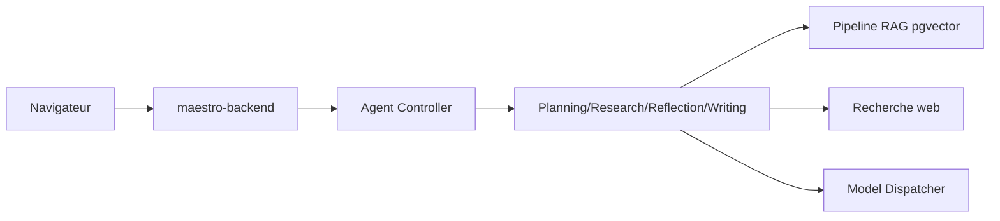

# murtaza-nasir/maestro

> Self-hosted AI research assistant: agents that plan, search your documents and the web, and write reports.

## The problem
A long document-based research task chains PDF reading, web searches, note-taking and writing, which are hard to hand off to a simple chat.

## What it actually does
A multi-agent platform (planning, research, reflection, writing) with RAG over your PDF, Word and Markdown documents (BGE-M3 embeddings, PostgreSQL and pgvector), web search (Tavily, LinkUp, Jina, SearXNG) and OpenAI-compatible LLMs, including Azure. Missions can be resumed after a pause. The README describes version 0.1.10-alpha.

## How it is wired


## Trying it
```bash
git clone https://github.com/murtaza-nasir/maestro.git
cd maestro
./setup-env.sh
docker compose up -d
docker compose logs -f maestro-backend
```

## Cost and gotchas
Docker Compose v2, 16 GB of RAM minimum, 30 GB of disk, startup takes 5 to 10 minutes. API keys from at least one provider; NVIDIA GPU detected automatically, otherwise `docker-compose.cpu.yml`.

## What it is not
Alpha version. The release notes stop in October 2025, and the architecture description provided (Streamlit, ChromaDB) does not match the README (PostgreSQL, pgvector, Docker). AGPL-3.0.

## Alternatives
No alternative named in the README.

## For you
Worth watching: a use case close to yours (assisted research over a corpus), but alpha, a single maintainer and contradictory documentation.
