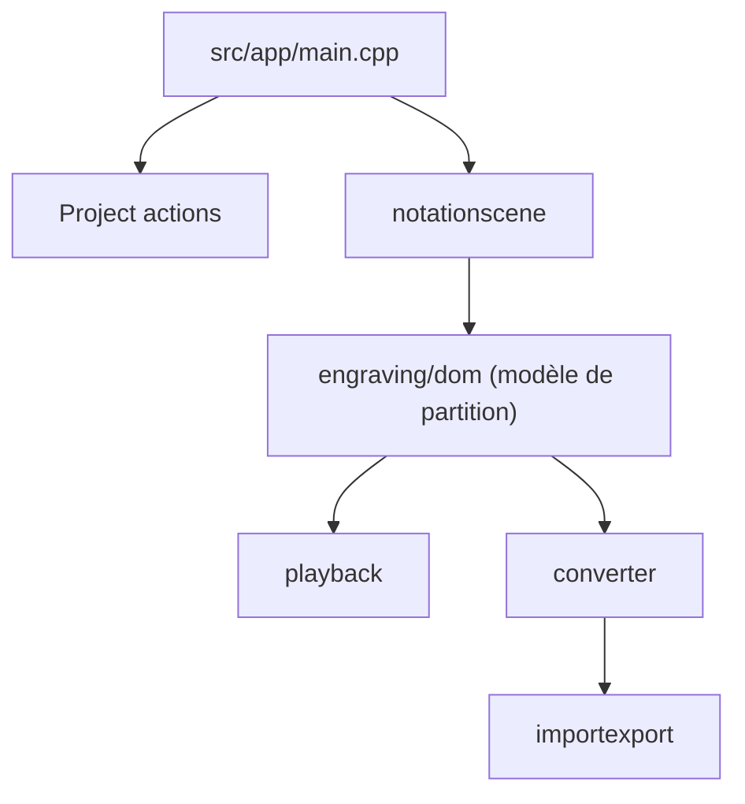

# musescore/MuseScore

> Free music notation and composition software for musicians and composers.

## The problem
Writing, playing and printing scores requires a full notation editor, without depending on paid software.

## What it actually does
WYSIWYG note entry, built-in sequencer and synthesizer, MIDI input. MusicXML, MIDI, MEI import/export, MuseData import, printing and PDF. The repository contains the C++ source code; the README describes building with CMake.

## How it is wired


## Trying it
```bash
git clone --recurse-submodules https://github.com/musescore/MuseScore.git
cd MuseScore
cmake -P build.cmake -DCMAKE_BUILD_TYPE=Release
cmake -P build.cmake -DCMAKE_BUILD_TYPE=Release run
```

## Cost and gotchas
Free. Long build with the `muse_framework` submodule; Ninja required on macOS. Dependency details are on the wiki.

## What it is not
Not a developer tool: desktop software. License present but not identified by GitHub, to be checked.

## Alternatives
No alternative named in the README.

## For you
Ignore: a music application unrelated to data, AI or MLOps, outside professional interest.
