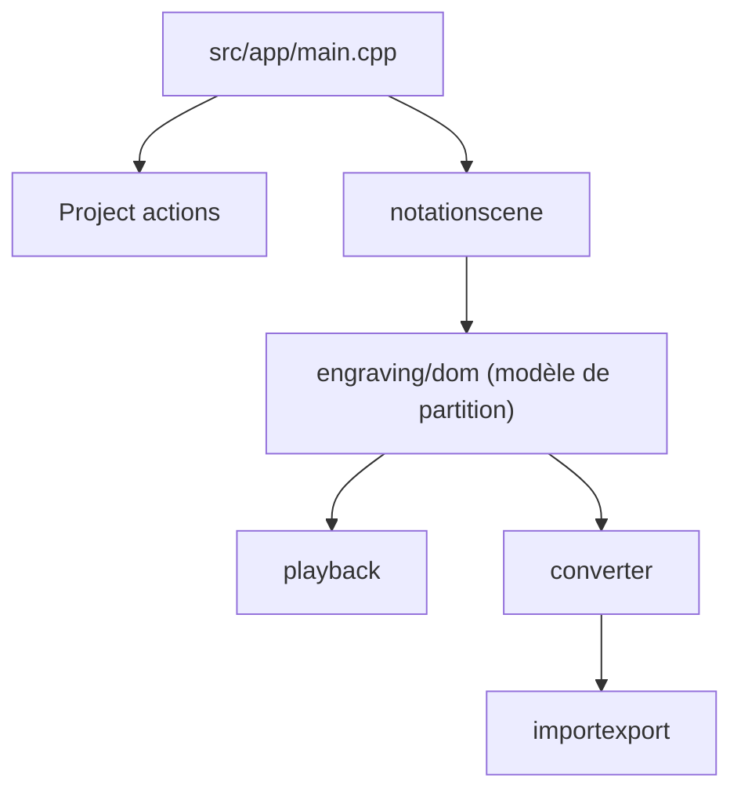

# musescore/MuseScore

> Logiciel libre de notation et composition musicale pour musiciens et compositeurs.

## Le problème
Écrire, jouer et imprimer des partitions demande un éditeur de notation complet, sans dépendre d'un logiciel payant.

## Ce que ça fait vraiment
Saisie de notes WYSIWYG, séquenceur et synthétiseur intégrés, entrée MIDI. Import/export MusicXML, MIDI, MEI, import MuseData, impression et PDF. Le dépôt contient le code source C++ ; le README décrit la compilation avec CMake.

## Comment c'est branché


## Essayer
```bash
git clone --recurse-submodules https://github.com/musescore/MuseScore.git
cd MuseScore
cmake -P build.cmake -DCMAKE_BUILD_TYPE=Release
cmake -P build.cmake -DCMAKE_BUILD_TYPE=Release run
```

## Coût et pièges
Gratuit. Compilation longue avec sous-module `muse_framework` ; Ninja requis sur macOS. Les détails des dépendances sont sur le wiki.

## Ce que ce n'est pas
Pas un outil pour développeurs : un logiciel de bureau. Licence présente mais non identifiée par GitHub, à vérifier.

## Alternatives
Aucune alternative nommée dans le README.

## Pour toi
À ignorer : application musicale sans lien avec data, IA ou MLOps, hors intérêt professionnel.

