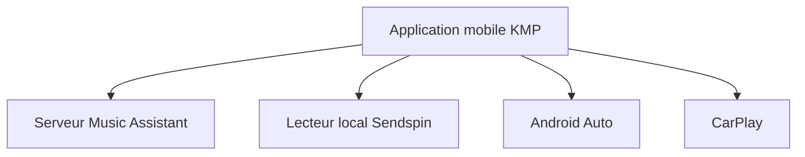

# music-assistant/mobile-app

> Official Android and iOS mobile app in preparation to control a Music Assistant server.

## The problem
Controlling your speakers and Music Assistant library from a phone requires a native app.

## What it actually does
Kotlin Multiplatform and Compose Multiplatform client. Manages the server's play queues and player groups. Plays locally on the device via the Sendspin protocol. Integrates Android Auto, CarPlay (very early) and Google Assistant voice commands.

## How it is wired

Simplified diagram based on the sheet, no diagram provided.

## Trying it
No command in the README: APK from the Releases for Android, TestFlight for iOS.

## Cost and gotchas
Requires an existing Music Assistant server. Android 9 minimum, iOS 18.5 minimum. No offline playback; the app is not yet published on the stores.

## What it is not
Not a standalone player nor a music server. Not yet production-ready, according to the author.

## Alternatives
No alternative cited in the README.

## For you
Ignore: unrelated to data, AI or MLOps work; useful only if you already use Music Assistant at home.
