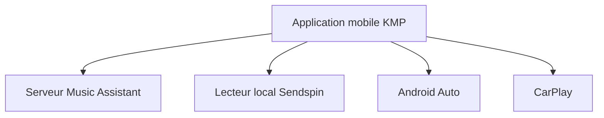

# music-assistant/mobile-app

> Application mobile Android et iOS officielle en préparation pour piloter un serveur Music Assistant.

## Le problème
Contrôler ses enceintes et sa bibliothèque Music Assistant depuis un téléphone demande une application native.

## Ce que ça fait vraiment
Client Kotlin Multiplatform et Compose Multiplatform. Gère les files de lecture et groupes de lecteurs du serveur. Lit localement sur l'appareil via le protocole Sendspin. Intègre Android Auto, CarPlay (très précoce) et les commandes vocales Google Assistant.

## Comment c'est branché

Schéma simplifié d'après la fiche, sans diagramme fourni.

## Essayer
Aucune commande dans le README : APK depuis les Releases pour Android, TestFlight pour iOS.

## Coût et pièges
Demande un serveur Music Assistant existant. Android 9 minimum, iOS 18.5 minimum. Pas de lecture hors ligne ; l'application n'est pas encore publiée sur les stores.

## Ce que ce n'est pas
Pas un lecteur autonome ni un serveur de musique. Pas encore prête pour la production, selon l'auteur.

## Alternatives
Aucune alternative citée dans le README.

## Pour toi
À ignorer : sans rapport avec un travail data, IA ou MLOps ; utile seulement si tu utilises déjà Music Assistant chez toi.

