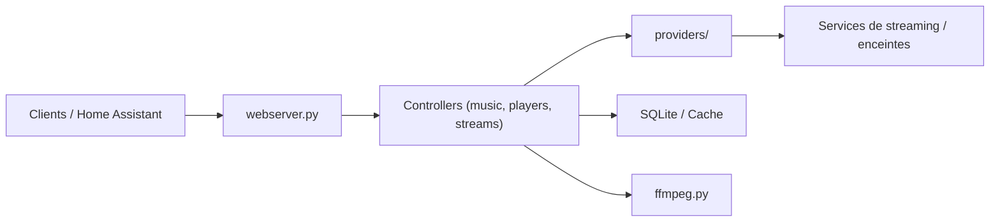

# music-assistant/server

> Music library server that links streaming services and connected speakers, for the home.

## The problem
Listening to your music from several services on speakers of different brands means as many applications.

## What it actually does
An asynchronous Python server, meant to stay on (Raspberry Pi, NAS). Pluggable providers handle music, players (Sonos, Chromecast, AirPlay, Snapcast) and metadata. It exposes an HTTP/WebSocket API and integrates with Home Assistant. It relies on ffmpeg and external binaries.

## How it is wired


## Trying it
```bash
scripts/setup.sh
python -m music_assistant --log-level debug
pytest
```
Python 3.14+ and ffmpeg 6.1+ are required. The recommended installation is a Home Assistant app.

## Cost and gotchas
Free, but streaming subscriptions remain at your expense.

## What it is not
Not a standalone player: the server is the core, the interface comes from elsewhere. Not designed for professional use.

## Alternatives
No alternative named in the README.

## For you
Ignore for work: it is music home automation, with no link to data/AI/MLOps.
