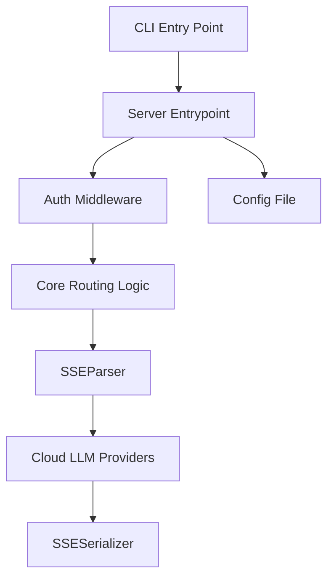

# musistudio/claude-code-router

> Local gateway that routes requests from Claude Code, Codex and other agents to the providers of your choice.

## The problem
Each coding agent has its own model configuration; switching providers means re-editing files every time.

## What it actually does
A local entry point (port 3456) for Claude Code, Codex, Grok CLI, Kimi CLI, OpenCode and others. Routing rules, ordered fallback, key rotation, additional tools (vision, web search, MCP). Request log with latency, tokens and estimated cost. Desktop app, npm CLI and Docker.

## How it is wired

This diagram describes an older version than the current README.

## Trying it
```sh
npm install -g @musistudio/claude-code-router
ccr ui
npm run docker:compose:up
```
UI at http://127.0.0.1:3458, gateway at http://127.0.0.1:3456.

## Cost and gotchas
Node.js 22 or later for the CLI. Provider keys are on you. Read the Docker guide before exposing the service remotely.

## What it is not
Not a model provider: it only redirects. It does not replace the coding agent itself. Over a thousand open issues.

## Alternatives
None named in the README.

## For you
Handy for driving several agents and providers with a single configuration and cost tracking; keep an eye on it given the number of issues and the single maintainer.
