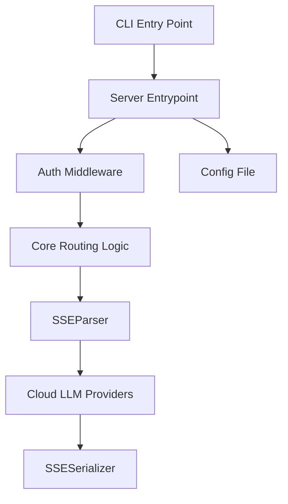

# musistudio/claude-code-router

> Passerelle locale qui route les requêtes de Claude Code, Codex et d'autres agents vers les fournisseurs de ton choix.

## Le problème
Chaque agent de code a sa propre configuration de modèle ; changer de fournisseur oblige à rééditer des fichiers à chaque fois.

## Ce que ça fait vraiment
Un point d'entrée local (port 3456) pour Claude Code, Codex, Grok CLI, Kimi CLI, OpenCode et d'autres. Règles de routage, repli ordonné, rotation de clés, outils additionnels (vision, recherche web, MCP). Journal des requêtes avec latence, tokens et coût estimé. Application de bureau, CLI npm et Docker.

## Comment c'est branché

Ce diagramme décrit une version plus ancienne que le README actuel.

## Essayer
```sh
npm install -g @musistudio/claude-code-router
ccr ui
npm run docker:compose:up
```
Interface sur http://127.0.0.1:3458, passerelle sur http://127.0.0.1:3456.

## Coût et pièges
Node.js 22 ou plus pour la CLI. Les clés des fournisseurs sont à ta charge. Lire le guide Docker avant d'exposer le service à distance.

## Ce que ce n'est pas
Pas un fournisseur de modèles : il redirige seulement. Il ne remplace pas l'agent de code lui-même. Plus d'un millier d'issues ouvertes.

## Alternatives
Aucune alternative nommée dans le README.

## Pour toi
Pratique pour piloter plusieurs agents et fournisseurs avec une seule configuration et un suivi des coûts ; à surveiller vu le nombre d'issues et le mainteneur unique.

