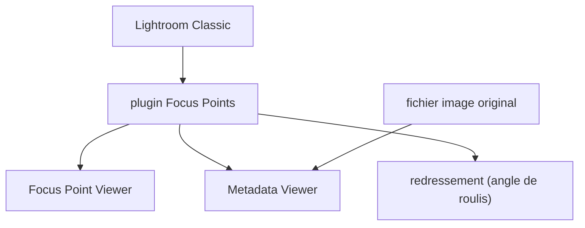

# musselwhizzle/Focus-Points

> Lightroom Classic plugin that shows where the camera focused and exposes the raw metadata.

## The problem
Lightroom imports and displays little of the autofocus information that the camera records.

## What it actually does
A viewer displays the active autofocus points, chosen zones, detected faces and subjects, and the crop mode. A metadata viewer reads the original file (EXIF, XMP, manufacturer data) with search. It straightens images according to the recorded roll angle and allows rating or labeling.

## How it is wired
Simplified diagram based on the fiche, no diagram provided.

## Trying it
No command in the README: you install the plugin following the repository's Quick Setup Guide, in Lightroom Classic.

## Cost and gotchas
Free plugin (Ko-fi donations), but Lightroom Classic is an Adobe product. Incompatible with Lightroom Desktop and Camera RAW. LR5.7 without labeling or straightening. The information depends on the camera model.

## What it is not
It is not an image editor, nor compatible with Lightroom Desktop.

## Alternatives
No alternative named in the README.

## For you
Ignore: a photography tool, unrelated to data / AI / MLOps.
