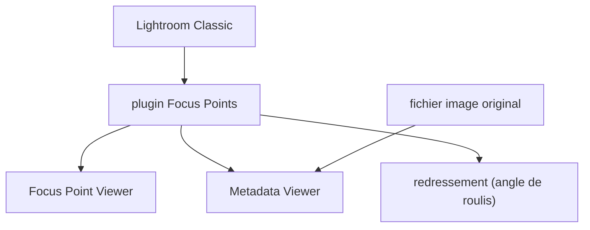

# musselwhizzle/Focus-Points

> Plugin Lightroom Classic qui montre où l'appareil a fait la mise au point et expose les métadonnées brutes.

## Le problème
Lightroom importe et affiche peu des informations d'autofocus que l'appareil photo enregistre.

## Ce que ça fait vraiment
Un visualiseur affiche les points d'autofocus actifs, zones choisies, visages et sujets détectés, et le mode de recadrage. Un visionneur de métadonnées lit le fichier original (EXIF, XMP, données constructeur) avec recherche. Il redresse les images selon l'angle de roulis enregistré et permet de noter ou étiqueter.

## Comment c'est branché
Schéma simplifié d'après la fiche, sans diagramme fourni.

## Essayer
Aucune commande dans le README : on installe le plugin selon le Quick Setup Guide du dépôt, dans Lightroom Classic.

## Coût et pièges
Plugin gratuit (dons Ko-fi), mais Lightroom Classic est un produit Adobe. Incompatible avec Lightroom Desktop et Camera RAW. LR5.7 sans étiquetage ni redressement. Les infos dépendent du modèle d'appareil.

## Ce que ce n'est pas
Ce n'est pas un éditeur d'images, ni compatible avec Lightroom Desktop.

## Alternatives
Aucune alternative nommée dans le README.

## Pour toi
À ignorer : outil de photographie, sans lien avec data / IA / MLOps.

