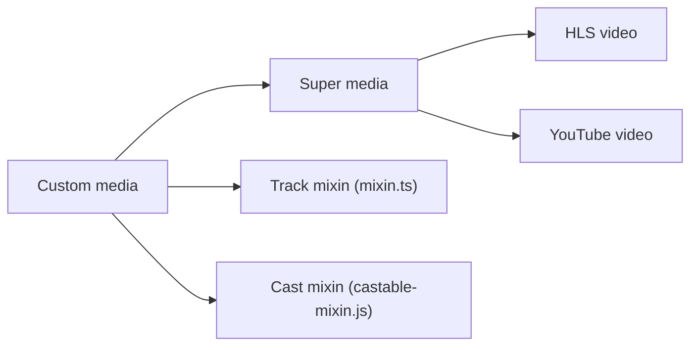

# muxinc/media-elements

> Collection of HTMLMediaElement-compatible HTML elements to drive YouTube, Vimeo, HLS, DASH and other players.

## The problem
Each third-party video player has its own API, which complicates building a single player.

## What it actually does
Provides custom elements that expose the native `<video>` or `<audio>` API on top of hls.js, dash.js, Shaka, YouTube, TikTok, Vimeo, Video.js, Spotify, Wistia, JW Player, Twitch, Cloudflare Stream and PeerTube. Add-on modules: tracks and renditions, played ranges, Cast broadcasting.

## How it is wired


## Trying it
```bash
# Aucune commande dans le README : il contient seulement un tableau des paquets.
```

## Cost and gotchas
Free. License: none declared in the catalog. The README, reduced to a table whose package names are missing from the supplied text, gives neither installation nor example.

## What it is not
Not a full player with an interface: these are elements to integrate.

## Alternatives
No alternative named in the README.

## For you
Ignore: a front-end video building block unrelated to data, AI or MLOps, and with an undeclared license.
