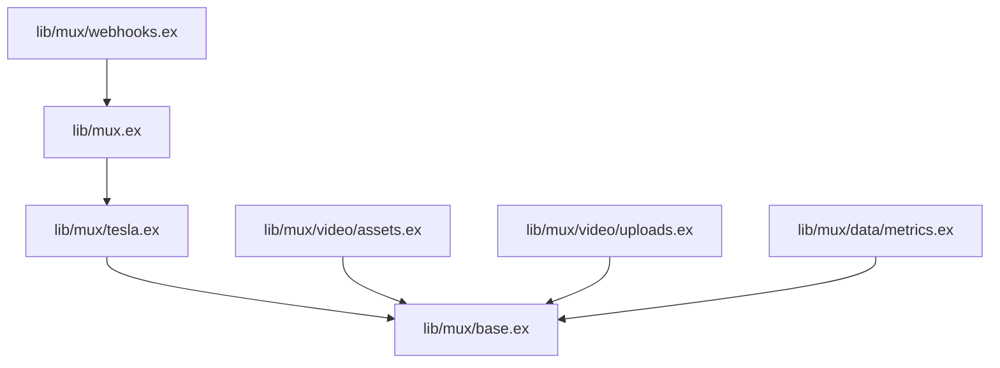

# muxinc/mux-elixir

> Official Elixir client for the Mux API, for Mux Video and Mux Data.

## The problem
Calling the Mux API to host video and measure its playback quality, from an Elixir or Phoenix application.

## What it actually does
A Tesla client with an access token, with Mux.Video modules (assets, live, uploads) and Mux.Data (metrics, views). Every successful response returns an :ok triple. Mux.Webhooks verifies webhook signatures on the raw body.

## How it is wired


## Trying it
```elixir
{:mux, "~> 3.2.2"}
client = Mux.client()
{:ok, asset, raw_env} = Mux.Video.Assets.create(client, %{input: "https://example.com/video.mp4"})
```

## Cost and gotchas
A Mux account and a token (identifier and secret) are required; the service is paid. Last push in July 2024.

## What it is not
Not a player or a standalone service: just an API client.

## Alternatives
- No alternative named in the README.

## For you
Ignore: only serves to integrate Mux from Elixir, and not recent.
