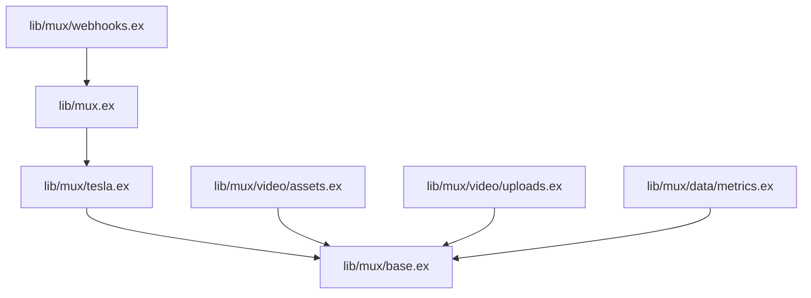

# muxinc/mux-elixir

> Client Elixir officiel de l'API Mux, pour Mux Video et Mux Data.

## Le problème
Appeler l'API de Mux pour héberger de la vidéo et mesurer sa qualité de lecture, depuis une application Elixir ou Phoenix.

## Ce que ça fait vraiment
Un client Tesla à jeton d'accès, avec des modules Mux.Video (assets, live, uploads) et Mux.Data (métriques, vues). Chaque réponse réussie renvoie un triplet :ok. Mux.Webhooks vérifie les signatures de webhooks sur le corps brut.

## Comment c'est branché


## Essayer
```elixir
{:mux, "~> 3.2.2"}
client = Mux.client()
{:ok, asset, raw_env} = Mux.Video.Assets.create(client, %{input: "https://example.com/video.mp4"})
```

## Coût et pièges
Un compte Mux et un jeton (identifiant et secret) sont requis ; le service est payant. Dernier push en juillet 2024.

## Ce que ce n'est pas
Pas un lecteur ni un service autonome : un simple client d'API.

## Alternatives
- Aucune alternative nommée dans le README.

## Pour toi
Ignorer : sert uniquement à intégrer Mux depuis Elixir, et peu récent.

