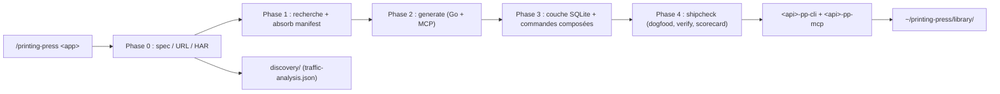

# mvanhorn/cli-printing-press

> Generator that turns an API or a website into a Go CLI, an MCP server and an agent skill.

## The problem
OpenAPI-based CLI generators wrap the endpoints and stop there: an agent has to chain ten calls for a question the domain could answer in a single one.

## What it actually does
Reads the official documentation, studies existing community CLIs and MCP servers, and reverse-engineers unpublished APIs through the browser. Each run produces two binaries (`<api>-pp-cli` in Cobra and `<api>-pp-mcp`), sharing the same `internal/client` and the same `internal/store`. High-gravity resources get dedicated SQLite tables with FTS5 indexes and incremental cursor-based sync, which makes composed commands (`stale`, `health`, `bottleneck`, `reconcile`) possible that a simple wrapper cannot offer. Automatic JSON output when piped, `--compact` for 60–80% fewer tokens, typed exit codes (`0/2/3/4/5/7`) so the agent corrects itself without parsing the error text. Four mechanical checks before publishing: scorecard, dogfood, behavior proof, live smoke test.

## How it is wired


## Trying it
```bash
curl -fsSL https://raw.githubusercontent.com/mvanhorn/cli-printing-press/main/scripts/install.sh | bash
curl -fsSL https://raw.githubusercontent.com/mvanhorn/cli-printing-press/main/scripts/install.sh | bash -s -- --skills-only --agent codex
go install github.com/mvanhorn/cli-printing-press/v4/cmd/cli-printing-press@latest
npx -y skills@latest add mvanhorn/cli-printing-press/skills --skill '*' -g -a claude-code -y
cli-printing-press --version
claude --plugin-dir .
cli-printing-press mcp-audit
```
Then, in the agent: `/printing-press Notion`, `/printing-press HubSpot codex`,
`/printing-press-polish notion`, `/printing-press-publish linear`, `/printing-press-amend`.

## Cost and gotchas
Go 1.26.6+, Node/npm, and a supported agent. The dominant cost is in tokens: the README advertises 60% less Opus with the `codex` mode, which gives the order of magnitude of the default mode. A full run is estimated at 22 to 50 minutes cumulated across the phases.

## What it is not
Not a standalone tool: the binary alone skips the curated agent loop, the skills alone have nothing to call — both are required. Not tested anywhere other than Claude Code; Codex support is announced as an experiment. Sniffing traffic on a third-party site is not legally neutral, and the README does not mention it. The README is truncated before the end of the verification section.

## Alternatives
- `discrawl` (Discord) and `gogcli` (Google Workspace): the handcrafted CLIs the project draws inspiration from.
- `schpet/linear-cli`, `4ier/notion-cli`: the community CLIs the press aims to absorb.

## For you
The idea of a "local SQLite layer + composed commands" is worth more than the generator itself.
