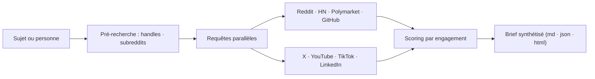

# mvanhorn/last30days-skill

> Multi-platform search activity over the past 30 days, ranked by actual engagement.

## The problem
No single engine can cover all of Reddit, X, YouTube, TikTok, and Polymarket: each platform is a separate ecosystem with its own API and authentication methods.

## What it actually does
Simultaneously query around 20 sources – Reddit (upvotes and top comments, without API key), Hacker News, Polymarket, GitHub, arXiv, Techmeme, Digg, X, YouTube, TikTok, Instagram, LinkedIn, StockTwits, Bluesky, Perplexity, and the web – and then a summarizing agent creates a single, ranked note based on what people have actually engaged with. Additional modes: topic discovery (`--discover`), tool comparison, `--hiring-signals`, `--as-of` for a past window, versioned JSON and standalone HTML export.

## How it is wired


## Trying it
```bash
npx skills add mvanhorn/last30days-skill -g
python3 skills/last30days/scripts/last30days.py --preflight
npx skills update last30days -g
```

## Cost and gotchas
Reddit, HN, Polymarket, GitHub, arXiv, and Techmeme are free and do not require a key. The others require your own key or browser cookies: ScrapeCreators (10,000 free calls, then pay-as-you-go), Brave Search (2,000 queries/month), Perplexity (pay-as-you-go), and X API for your developer project. The results are saved by default in `~/Documents/Last30Days/`.

## What it is not
This is not a unified engine: it's a bridge between isolated platforms, the availability of which depends on access that can be disrupted. The ranking reflects engagement, not necessarily accuracy. Windows is partially supported (Claude Desktop bundle delayed).

## Alternatives
- TweetClaw: Companion plugin for X actions, not officially endorsed.

## For you
Key considerations: These are valuable assets, provided that the costs of obtaining and maintaining them, as well as the potential fragility of salvaged materials, are taken into account.
