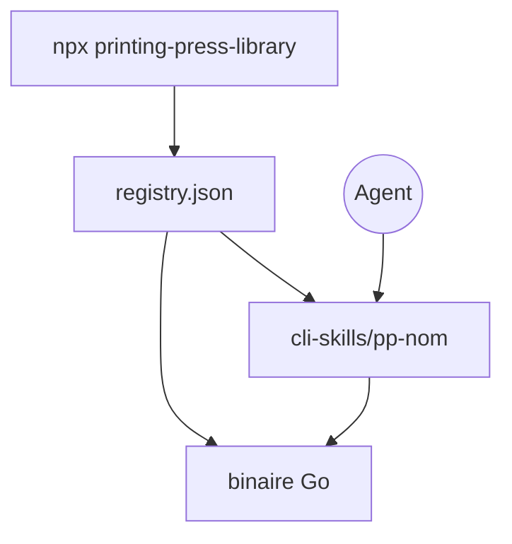

# mvanhorn/printing-press-library

> Catalog of 518 Go CLIs for agents, each with a dedicated skill, installable via npx.

## The problem
An agent that needs to call ESPN, Sentry or a flight engine wastes time on documentation and trial and error, hence tokens.

## What it actually does
Lists 518 CLIs in 22 categories, generated by "CLI Printing Press" and signed by different contributors. The npm installer reads `registry.json`, fetches the Go binary (pinned to a `source_commit`) and the skill `cli-skills/pp-<name>`. Several tools keep a local SQLite mirror to query offline. Some sources are "sniffed", with no official API.

## How it is wired
The code diagram is not supplied; diagram based on the README.


## Trying it
```bash
npx -y @mvanhorn/printing-press-library install starter-pack
npx -y @mvanhorn/printing-press-library search flights
npx skills add mvanhorn/printing-press-library/cli-skills/pp-espn -g -y
```

## Cost and gotchas
API keys or browser sessions depending on each tool; the cost depends on the targeted service. No license declared on the repository. 113 open issues. The live catalog is not authenticated, only the binary is pinned.

## What it is not
Not a single tool: a showcase of CLIs of uneven quality and varied sources. Unofficial endpoints can break without notice.

## Alternatives
No alternative named in the README.

## For you
Keep an eye on it: a few CLIs (Airflow, Airbyte, ClickHouse Cloud, Azure) speak to your field, but the lack of a license and uneven quality require choosing case by case.
