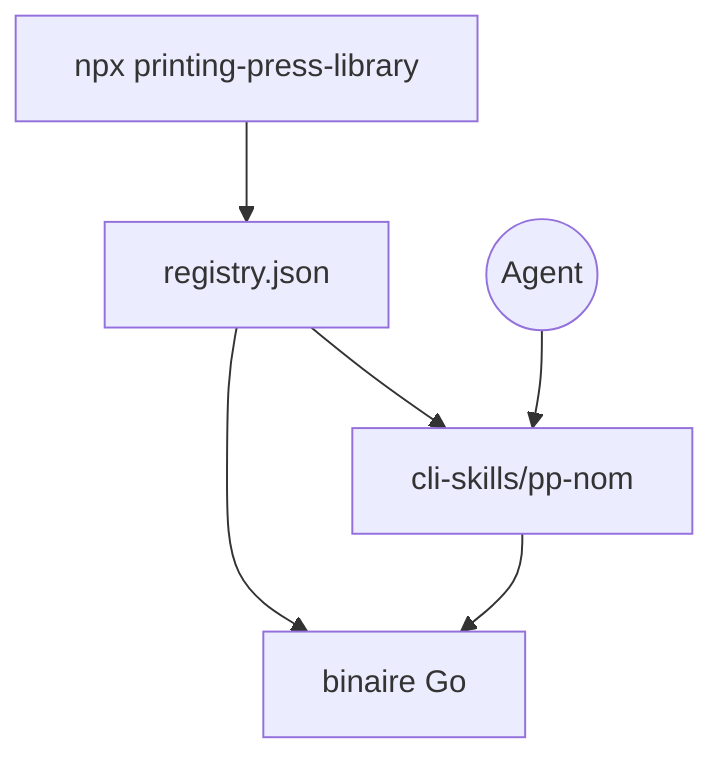

# mvanhorn/printing-press-library

> Catalogue de 518 CLI en Go pour agents, chacun avec un skill dédié, installables par npx.

## Le problème
Un agent qui doit appeler ESPN, Sentry ou un moteur de vols perd du temps en documentation et en tâtonnements, donc en jetons.

## Ce que ça fait vraiment
Répertorie 518 CLI en 22 catégories, générés par « CLI Printing Press » et signés par des contributeurs différents. L'installateur npm lit `registry.json`, récupère le binaire Go (épinglé sur un `source_commit`) et le skill `cli-skills/pp-<nom>`. Plusieurs outils tiennent un miroir SQLite local pour requêter hors ligne. Certaines sources sont « sniffées », sans API officielle.

## Comment c'est branché
Le diagramme de code n'est pas fourni ; schéma d'après le README.


## Essayer
```bash
npx -y @mvanhorn/printing-press-library install starter-pack
npx -y @mvanhorn/printing-press-library search flights
npx skills add mvanhorn/printing-press-library/cli-skills/pp-espn -g -y
```

## Coût et pièges
Clés d'API ou sessions navigateur selon chaque outil ; le coût dépend du service ciblé. Aucune licence déclarée sur le dépôt. 113 issues ouvertes. Le catalogue vivant n'est pas authentifié, seul le binaire est épinglé.

## Ce que ce n'est pas
Pas un outil unique : une vitrine de CLI de qualité inégale et de sources variables. Les endpoints non officiels peuvent casser sans préavis.

## Alternatives
Aucune alternative nommée dans le README.

## Pour toi
Surveiller : quelques CLI (Airflow, Airbyte, ClickHouse Cloud, Azure) parlent à ton métier, mais absence de licence et qualité hétérogène imposent de choisir au cas par cas.

