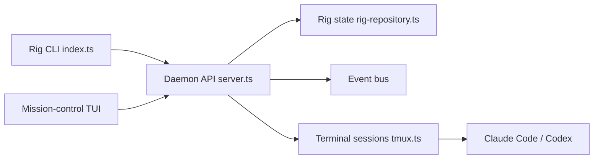

# mvschwarz/openrig

> Orchestrates a team of Claude Code and Codex agents in tmux from YAML, with a TUI and messaging.

## The problem
Several code agents launched by hand give a pile of terminal sessions with no structure and no recovery after a restart.

## What it actually does
A Hono daemon with a CLI, a TUI and an MCP server, on top of SQLite and tmux. You describe teams (pods, seats, links) in a YAML RigSpec, `rig up` starts them, and `rig down --snapshot` saves and restores them. Agents communicate through `rig send`, `rig broadcast` and `rig chatroom`. Bundled teams: `starter`, `workshop`, `factory`, plus review, research, pm. Existing tmux sessions can be adopted.

## How it is wired


## Trying it
```bash
npm install -g @openrig/cli
rig setup --dry-run
rig specs preview starter --kind rig
rig up starter --cwd .
rig send dev-build@starter 'Implement <one useful change>...'
```

## Cost and gotchas
Model costs remain on you (Claude Code or Codex account). `rig setup` modifies `~/.tmux.conf`, `~/.claude.json`, `~/.codex/config.toml` and the project settings, with hooks and trust; the kernel receives broad permissions (Codex: `danger-full-access`). Back up first. Windows only via WSL2.

## What it is not
Not an agent: it manages the team, not the agents. No guarantee of rollback on modified files. Per the README, the tests do not run under WSL2.

## Alternatives
- Claude Managed Agents: managed service, compared in the README.

## For you
Worth watching: the idea of declarative, resumable teams is useful for multi-agent development, but the footprint on your personal config and the broad permissions call for a trial on a disposable machine.
