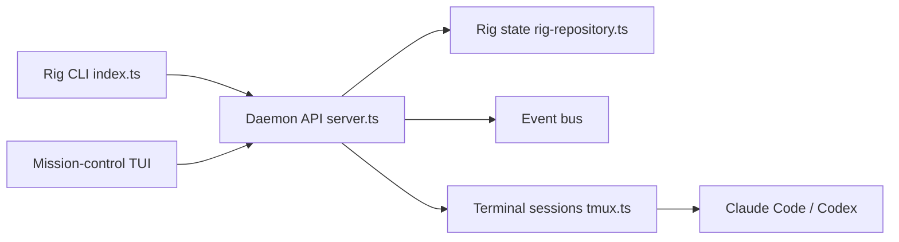

# mvschwarz/openrig

> Orchestre en YAML une équipe d'agents Claude Code et Codex dans tmux, avec TUI et messagerie.

## Le problème
Plusieurs agents de code lancés à la main donnent un tas de sessions de terminal sans structure ni reprise après redémarrage.

## Ce que ça fait vraiment
Un daemon Hono avec CLI, TUI et serveur MCP, sur SQLite et tmux. On décrit les équipes (pods, sièges, liens) dans un RigSpec YAML, `rig up` les démarre, `rig down --snapshot` les sauvegarde et les restaure. Les agents communiquent via `rig send`, `rig broadcast` et `rig chatroom`. Équipes fournies : `starter`, `workshop`, `factory`, plus review, research, pm. Les sessions tmux existantes peuvent être adoptées.

## Comment c'est branché


## Essayer
```bash
npm install -g @openrig/cli
rig setup --dry-run
rig specs preview starter --kind rig
rig up starter --cwd .
rig send dev-build@starter 'Implement <one useful change>...'
```

## Coût et pièges
Le coût des modèles reste à ta charge (compte Claude Code ou Codex). `rig setup` modifie `~/.tmux.conf`, `~/.claude.json`, `~/.codex/config.toml` et les settings du projet, avec hooks et trust ; le kernel reçoit des permissions larges (Codex : `danger-full-access`). Sauvegarde avant. Windows seulement via WSL2.

## Ce que ce n'est pas
Pas un agent : il gère l'équipe, pas les agents. Pas de garantie de retour arrière sur les fichiers modifiés. Les tests ne tournent pas sous WSL2 d'après le README.

## Alternatives
- Claude Managed Agents : service géré, comparé dans le README.

## Pour toi
À surveiller : l'idée d'équipes déclaratives et reprenables est utile pour du dev multi-agents, mais l'empreinte sur ta config perso et les permissions larges demandent un essai sur une machine jetable.

