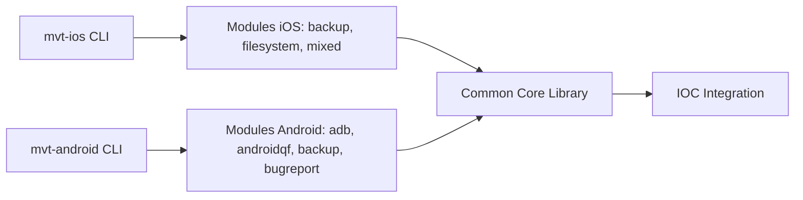

# mvt-project/mvt

> Amnesty's forensic toolkit for detecting traces of compromise on Android and iOS.

## The problem
Spotting spyware such as Pegasus on a phone requires acquiring and analyzing technical traces.

## What it actually does
Three commands: `mvt-ios`, `mvt-android` and `mvt` (version, completion, plugins, `download-iocs`). Analysis of backups, filesystems, bug reports and ADB modules, comparing traces against public indicators of compromise. Plugins add modules and commands. Published by Amnesty International Security Lab in 2021.

## How it is wired


## Trying it
```bash
pip3 install mvt
uv tool install mvt
mvt completion bash
```

## Cost and gotchas
Free, but reserved for forensic profiles. The "v3" branch introduced breaking changes that may break scripts. License not identified by GitHub.

## What it is not
Not a general-public self-assessment tool. Public indicators do not prove that a device is clean.

## Alternatives
No alternative cited in the README (help from Amnesty's Security Lab and the Access Now Helpline is mentioned).

## For you
Worth watching: serious and well maintained, useful only if you do mobile investigation; outside the usual data/AI scope.
